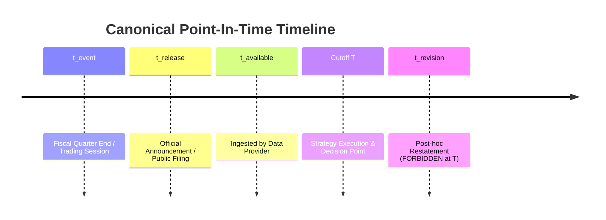

# ADR-0005: Point-In-Time (PIT) Information-State Semantics & Negative Boundaries (RI-02)

- **Status**: DRAFT (Proposed under Track B / PR #1296)  
- **Context Date**: 2026-10-26  
- **Deciders**: Personal Quant Workstation Owner & Architecture Agent  
- **Supersedes / Extends**: ADR-0003, `repository_data_convergence.md`  

---

## 1. Context & Problem Statement

Quantitative research across distinct asset classes and markets (US Equities, CN Equities, Reference ETFs) frequently encounters subtle lookahead bias and hindsight data corruption:
1. **Filing Lag vs Event Period**: A company's Q3 ends on September 30, but the 10-Q/quarterly report is released on November 10. Using Q3 data on October 15 is a severe lookahead violation.
2. **Post-Cutoff Restatements**: Financial statements and dividend records are sometimes retroactively restated months or years later. Backtesting against restated data tests against information that was impossible to know at execution time.
3. **Adjustment Flips**: Splitting or paying dividends alters historical adjusted prices. Mixing raw prices with post-split adjustments creates false arbitrage or misleading factor values.
4. **Delisting & Suspension**: Survivorship bias occurs when backtests evaluate only stocks currently trading, ignoring those that suspended trading or delisted during the historical window.

Alpha Engine requires an authoritative, model-agnostic definition of **Information State at Cutoff $T$** (`as-of $T$`).

---

## 2. Decision: The Five-Timestamp Information State Model

For any observation $O$ evaluated at cutoff $T$, the system distinguishes five canonical timestamps:

1. **$t_{event}$ (Event Time)**: The period or physical occurrence date (e.g., fiscal quarter end date `2026-09-30`, trading session date `2026-10-23`).
2. **$t_{release}$ (Public Release Time)**: The earliest timestamp when the information became publicly disseminated (e.g., SEC EDGAR filing timestamp, exchange announcement date).
3. **$t_{available}$ (Vendor Ingestion Time)**: The timestamp when the data provider ingested and verified the record.
4. **$t_{retrieved}$ (Workstation Query Time)**: The actual wall-clock execution time when Alpha Engine retrieved and sealed the observation into local evidence.
5. **$t_{revision}$ (Revision Timestamp)**: The timestamp of any subsequent amendment or restatement by the issuer or vendor.

### The Cardinal PIT Constraint
An observation $O$ is eligible for strategy evaluation at cutoff $T$ if and only if:
$$\max(t_{release}, t_{available}) \le T$$

If a restatement occurs at $t_{revision} > T$, the restated value is **strictly forbidden** in historical evaluation as of $T$. The evaluation must utilize only the value known at $T$.

---

## 3. Data Representation Rules

### 3.1 Raw Prices vs Adjusted Bases
- **Raw OHLCV**: Always preserved immutably as reported by the exchange.
- **Adjustment Factors**: Versioned explicitly with corporate action effective dates (`ex_date`).
- **Chain-Linked Series**: When continuous adjusted bars are materialized, the adjustment base anchor date must be explicitly declared. Never mix adjustment bases across different cutoff dates without an explicit bridge.

### 3.2 Missing Values vs Zero
- Missing financial statement items or unavailable trading bars must be represented as **`NaN` / `missing`**, never coerced to zero.
- Coercing missing data to zero falsifies factor values (e.g., R&D expense, debt ratios, volume).
- Where required inputs are missing at cutoff $T$, the strategy state must become `data_blocked`, not forward-filled.

### 3.3 Universe Membership (Point-In-Time Cross Section)
- Strategy cross-sections at cutoff $T$ are filtered against the candidate pool's eligibility status at $T$.
- Suspended stocks are flagged as non-tradable; delisted stocks cease trading on their delisting date.

---

## 4. Negative Test Matrix & Assertions (Negative Verification)

Every PIT data adapter and query interface must pass the following negative assertions:

| Test Case ID | Failure Injection | Expected Engine Behavior | Severity |
| :--- | :--- | :--- | :--- |
| **PIT-NEG-01** | Query Q3 fundamental data with cutoff $T < t_{release}$ | Raise `LookaheadViolationError` or return `None` (fail-closed) | **P0 (Critical)** |
| **PIT-NEG-02** | Supply a post-cutoff restatement where $t_{revision} > T$ | Ignore revision; retain original verified snapshot at $T$ | **P0 (Critical)** |
| **PIT-NEG-03** | Request candidate trading on an unlisted or delisted session | Raise `NonTradableSessionError`; exclude from active weights | **P1 (High)** |
| **PIT-NEG-04** | Attempt to join unaligned US and CN calendar sessions | Raise `CalendarMismatchError` without explicit cross-market bridge | **P1 (High)** |
| **PIT-NEG-05** | Input volume with mismatched vendor scaling (e.g. lots vs shares) | Flag unit discrepancy warning; do not invalidate price match | **P2 (Operational)** |

---

## 5. Consequences & Boundaries

- **Preserves Historical Integrity**: Eliminates hindsight leaks across all research studies.
- **Fail-Closed Governance**: Enforces that missing historical documentation results in an honest `blocked` gate, rather than an unverified simulation.
- **No Performance Inflation**: Prevents artificial boosting of Sharpe ratios through knowledge of future earnings or post-announcement revisions.
