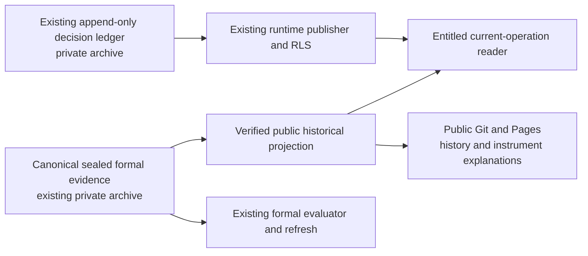

# #1288 — current-operation publication boundary repair proposal

**DRAFT / owner architecture review required before implementation.**
This proposal preserves current AGENTS, four accepted strategies, public formal
history, protected current-operation capability, existing RLS and immutable
evidence. It does not authorize policy changes, source rewriting or deployment.

## Verified problem and extent

At deployed/main `58a56c14c18197f700ab00b526513a571aff35be`, anonymous requests
read the CN_27 formal lineage's `source_evidence.operating_state`, including
current/target weights and factor evidence. The existing Pages verifier checks
the public operations shell but not operational content in all formal sections.

The repository itself is public. A further
[anonymous source audit](../evidence/product_v1/public_source_boundary_1288.json)
read all four active decision ledgers' `latest.json` files and the same CN_27
lineage from the exact public Git commit: **5/5 HTTP 200, 5/5 contain operating
fields**. Only resource paths, hashes, field names and counts are retained here;
no allocation values. Removing one Pages field or changing RLS cannot close
this independent source bypass. Existing live strategy policies also all declare
public; that owner policy choice must be reviewed separately from static leakage.

Historical public Git objects cannot be made confidential retrospectively.
Do not rewrite history or relabel disclosed evidence. The repair must stop
future current-data publication and record the historical exposure as residual
risk. A4 stays FAIL until the whole boundary is verified.

## Proposed decision

Keep formal historical research public. Keep new current decisions, targets,
drivers, delivery details and operational state in the **existing private
archive and current-operation runtime**. Retain existing Strategy Decision
Ledger formats and append-only authority; change their delivery/storage boundary,
not their meanings or model identities. Reuse existing workflows/archive access;
no new service, scheduler, model registry or state database.

This is a publication-contract change. A one-line redaction of copied lineage
is rejected: it changes section bytes while retaining the old section digest,
manifest hash and bundle identity. Deleting lineage outright is also rejected:
it loses formal provenance and breaks existing verified readers.

## Exact identity contract to review

1. Preserve the canonical sealed source bytes, canonical bundle/run/model IDs
   and failed research evidence in the existing private archive. Keep their
   manifests independently verifiable by authorized local/workflow consumers.
2. Generate one disposable **public historical projection** through the existing
   `sync-formal-model-runs.mjs` path. Replace the current whole-tree public copy;
   do not maintain a second fallback export.
3. Give changed public content its own projection manifest/section hashes and
   projection identity. Carry explicit immutable `source_identity` binding to
   the canonical model/run/bundle/manifest hash and a versioned projection
   contract. Never label the sanitized bytes as the original canonical bundle.
4. The public catalog remains a generated consumer view of the existing active
   registry/canonical catalog. No second strategy registration or promotion.
   Browser readers validate projection bytes and the exact source binding.
   Current runtime rows must match that canonical source identity, not be
   incorrectly compared with a derived content digest.
5. Limit the public projection to declared historical performance, risk,
   holdings/trades/attribution and their historical provenance. Exclude current
   operational subtrees throughout the graph, not merely known weight keys.
   Full canonical lineage remains available to authorized research/replay.
6. Unknown projection versions, changed identities, missing archive inputs,
   unclassified fields, symlinks or stale source mappings fail closed. No
   browser reconstruction of withheld current observations.

The full canonical-to-public binding and browser acceptance rules need an
explicit versioned contract change reviewed before coding. A successful hash
check alone does not certify the public/private field classification.

## Minimal implementation sequence after approval

| Slice | Existing paths / outcome | Verification |
| --- | --- | --- |
| Private ledger retention | Existing current-target/outbox jobs hydrate and append exact ledger records through the existing private archive; stop committing new current records into public main | Append/retry/idempotency, old record hashes unchanged, archive binding verified, runtime read retains exact identities |
| Canonical source retention | Existing formal refresh archives complete canonical state privately; historical public output uses explicit projection binding | Full canonical replay still passes; archive outage blocks affected publication without substituting stale success |
| Public projection and reader | Replace whole-tree copy in sync-formal-model-runs; update existing formal/public readers and release verifier for the reviewed projection identity | Exact canonical mapping, public historical functionality, no raw current subtree in any published section or linked object |
| Existing release/security tests | Extend current Pages/static acceptance and negative tests; no new workflow | Anonymous direct Git/Pages/source URLs, section traversal, forged/mismatched projection, denied/revoked/expired runtime reads |
| Controlled cutover | Owner-approved exact candidate and intended current tiers; existing publish/recovery workflows | Actual deployed request traces, retained failure history, qualified rollback target and owner signoff |

Check **every** public channel that can copy these paths: source Git, Pages,
release attachments, build/browser artifacts, logs and linked source receipts.
An unprotected source URL must not be advertised as confidential provenance.
Public historical evidence may support independent research inference; the
guarantee is removal of direct current-operation payloads, not secrecy of public
formulas or historical portfolios.

## Acceptance and negative cases

- Anonymous static/source reads never return newly protected current decisions,
  weights, targets, drivers or delivery provenance; a UI gate is insufficient.
- All four accepted public historical journeys and linked instruments remain
  readable, with real prices and historical markers, no invented fills.
- Canonical source identities remain exact; sanitized content has distinct
  declared hashes/identity. Old and unknown consumer formats cannot bypass it.
- Missing private inputs, wrong source SHA, extra undeclared field and revoked
  account each block the affected read/release while preserving independent
  valid history at its actual cutoff.
- Original canonical/failed evidence hashes do not change during migration or
  rollback. No history rewrite or strategy/pool/cost/entitlement mutation.
- Actual intended public/authenticated/Pro/owner tiers are reviewed and tested
  by the owner. Existing public policy rows do not prove Pro-denial behavior.

## Rollback and release decision

Rollback must retain the last **privacy-qualified** public projection and the
existing private ledger. The earlier copied-tree Pages artifact is not a safe
rollback target merely because its structure verifies. A failed cutover must
not republish raw canonical/current files as a compatibility path.

Release remains NO-GO. Proposed next owner decision: approve this existing-store,
explicit-projection direction and intended live tiers, then implement the
bounded slices above. Making all current observations permanently public would
be a separate product-scope change; it is not assumed by one-operator v1.
