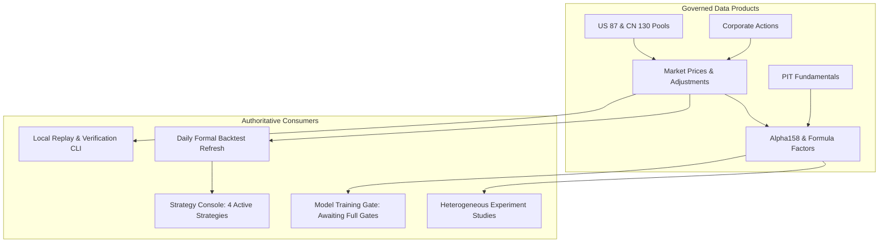

# Investment Research Infrastructure: Data Product, Consumer & Rights Lineage Matrix (RI-01)

> **Authority**: PR #1296 (Track B / Long-Term Platform Umbrella)  
> **Milestone**: Wave B0 (Source and Consumer Lineage Inventory)  
> **Status**: DRAFT FOR OWNER REVIEW  
> **Scope**: Enumerates all governed data products, authoritative stores, consumers, rights boundaries, and blocker statuses across US and CN markets.

---

## 1. Candidate Universes & Reference Instruments

| Asset Class | Identifier / Config Path | Size | Role | Governance Rule | Authoritative Storage |
| :--- | :--- | :--- | :--- | :--- | :--- |
| **US Candidate Pool** | `configs/research_universes/us_selected_equities_v2.yaml` | 87 equities | Cross-sectional selection pool | Market-isolated, survivorship-disciplined | `configs/pools/selected_pool_registry_v1.yaml` |
| **CN Candidate Pool** | `configs/research_universes/cn_selected_equities_v3.yaml` | 130 equities | Cross-sectional selection pool | Market-isolated, tradability-bounded | `configs/pools/selected_pool_registry_v1.yaml` |
| **US Reference ETFs** | `QQQ`, `QQQI`, `TQQQ` | 3 ETFs | Regime context & strategy portfolio | Distinct from equity cross-section | `configs/pools/reference_instrument_registry_v1.yaml` |
| **CN Reference ETFs/Indices** | `515180.SH`, `000300.SH` | 1 ETF, 1 Index | Benchmark & defensive allocation | Strict ETF vs Index role separation | `configs/pools/reference_instrument_registry_v1.yaml` |

---

## 2. Market Price & Quote Products

| Data Product | Upstream Sources | Price Mode | Fields Provided | Credential Env | Redistribution Rights | Authoritative Consumer |
| :--- | :--- | :--- | :--- | :--- | :--- | :--- |
| **US Selected Equities Daily Bar** | Yahoo Finance | Adjusted & Raw | Open, High, Low, Close, Volume | None (Public) | Research only; bulk redistribution restricted | `us_x1_3`, US Research Backtests |
| **CN Selected Equities Daily Bar** | Tushare Pro (Primary), Akshare Sina (Fallback), Tencent (Fallback) | QFQ / Raw + Adjustment Factor | Open, High, Low, Close, Volume, Factor | `TUSHARE_TOKEN` | Token permissions govern; research-only retention | `cn_27_v1_3`, `cn_x1_2`, CN Research Backtests |
| **US Professional Reference Bundle** | Yahoo Finance (Research v2), Tiingo (Authorized professional) | Adjusted Total Return | Close, Split Factor, Dividend | `TIINGO_API_TOKEN` | Commercial license limits raw export | `qqqi_qqq_tqqq_v4_3` Reference Evaluation |
| **BYD Canonical Snapshot** | Sealed Historical Snapshot + Prospective Shadow | Chain-linked Adjusted OHLCV | Open, High, Low, Close, Volume | None (Sealed base) | Historical immutable archive | `byd_v1_3_recovery_event_low_vol_confirmation_v1` |

---

## 3. Fundamental, Corporate Action & Factor Products

| Data Product | Authoritative Schema | Active Coverage | Timeliness / PIT Boundary | Known Gaps & Blockers | Primary Consumer |
| :--- | :--- | :--- | :--- | :--- | :--- |
| **PIT Fundamentals** | `fundamental_event_store_v1` | US 87 / CN 130 | Filing date / announcement date strictly lagged | Chinese quarterly reports require vendor reconciliation | Cross-sectional factor calculation |
| **Corporate Actions** | `corporate_action_store_v1` | Splits, Dividends, Delistings | Effective execution date (`ex_date`) | Complex stock dividends require dual-source confirmation | Adjustment factor calculation |
| **Alpha158 Factor Library** | `configs/factor_libraries/` | CN 130 Equities | Daily lagging open-to-open features | Training profiles for multi-factor models currently scoped | `cn_x1_2`, Cross-sectional experiments |
| **RDI Research Readiness** | `docs/evidence/ashare_rdi_phase2/` | CN Equities | 7 / 14 / 28 day event horizons | Historical source families uncertified; status explicitly BLOCKED | Research exploration only (not formal strategy) |

---

## 4. Consumer Lineage Map

---

## 5. Provenance & Research Limits

1. **No Synthetic Backfilling**: If fundamental statements or price bars are unavailable for a historical window, the status must remain `partial` or `blocked`. Never forward-fill.
2. **License Isolation**: Commercial vendor data (e.g., Tiingo) is strictly scoped to authorized reference bundles; it is never mixed into uncredentialed public distribution.
3. **Research-Only Boundary**: All outputs retain `research_only=true` and `trade_ready=false`.
