# P2-E3 · Alpha Engine research execution v2 — measured, resumable CPU-first orchestration

**Status:** DESIGN + FIRST VERTICAL-SLICE IMPLEMENTATION CONTRACT. Research review: [US87 v6 scientific assessment](../research/us87_v6_261_research_review_2026-11-07.md). This architecture is **not** installed into the already frozen v6 batch; changing the executor/trainer changes runner/source hashes and requires a new batch identity.

## Product outcome

Make a research campaign a bounded, reproducible **graph of distinct valid experiments**, not an unbounded sequence of seeds or a GPU spend target. Maximize **independently useful experiments per elapsed hour and per Compute Unit**, while retaining exactly one authoritative coordinator, inspectable immutable receipts and no silent model promotion.

### Controlling baseline

US87 v6: 29 configurations × 3 chronological folds × 3 declared seeds = 261 completed tasks, 40.17 min sum of task timers; 87 config/fold groups yielded one observed performance vector each (174 redundant vectors). Baseline is *not* a measured Colab CPU utilization nor a hardware-independent timing benchmark. A faster runtime is not assumed beneficial until same-code/data/feature/metric parity is demonstrated.

## Architecture and stable contracts

```mermaid
flowchart LR
  A[Hash-pinned v6+ source and rights] --> B[Data audit and isolated stage]
  B --> C[Fold and feature cache compiler]
  C --> D[Immutable task DAG]
  D --> E[Resource-aware coordinator]
  E --> F[CPU worker pool 1 / 2 / 4]
  F --> G[Private per-task scratch and receipts]
  G --> H[Single receipt verifier and publisher]
  H --> I[Single checkpoint and recovery tip writer]
  I --> J[Paired research audit and model comparison]
```



**Do not create a second research evaluator.** V2 workers call the existing `run_study`/native XGB and LightGBM adapters with the same frozen spec and validated data. The planner controls preparation/execution and the coordinator owns publication. Existing `colab_experiment_batch` remains the fallback serial executor.

### 1. Frozen run and task identity

`dataset_id` = manifest SHA + US history ZIP SHA + owner-approved cloud-rights attestation SHA + price-mode/adjustment unit. `evaluator_id` = runner Git commit + Python/uv lock + Study Workspace contract version. `fold_id` includes exact train/embargo/test date limits. `task_id` includes config params, model family, feature group, seed and intended cost scenario.

A task may be `aliased_to` another **only** with an explicit, versioned **effective deterministic-spec equivalence** proof (not because two final return numbers match). The proof must include effective engine parameters, real seed consumption path, stochastic subsampling state, full feature/label identity and numeric parity. Original seed IDs remain as transparent metadata; do not manufacture three distinct scientific observations from aliases.

Versioned task states: `PLANNED → LEASED → FINISHED_PRIVATE → VERIFIED → PUBLISHED`, or `BLOCKED`. A crash may reset an expired `LEASED` to `PLANNED`, but may never mutate a published result. Unique task ID + output receipt SHA provides idempotence.

### 2. Cache DAG: prepare once, reference many times

- Source stage `StageKey(source_manifest_sha, history_sha, rights_sha)`; immutable outside Git or Drive sync during active compute.
- Prepared features `FeatureKey(source_sha, candidate_pool_snapshot, price_mode, fold_train/test/embargo boundaries, lookback, label_horizon, feature IDs, preprocessing implementation SHA, adjustment semantics)`. **Cache only deterministic, causally valid artifacts**, and never merge train-label rows with validation or reserved holdout rows.
- Native fit `FitKey(feature_key, model_family, effective_params, actual_seed, engine version)`.
- Portfolio evaluation `EvalKey(fit_key, top_k, benchmark, cost, slippage, simulator_sha)`. Existing cost-stress pairs may reuse a validated *frozen model + score stream* if there are no cost-dependent fitting/decision parameters; never assume without verification.

Cache artifacts are content-addressed, read-only and size-budgeted; the coordinator stores their path/hash identities in task receipts. **No fit-cache reuse across price-edition, code, fold, universe/PIT or feature semantic changes.** First implementation needs only the strongest shared preprocessing cache and must prove parity against fresh full pipeline.

### 3. CPU resource scheduling (MVP)

Start **CPU-first**. Trial execution currently invokes XGBoost CPU `hist` and LightGBM with `num_threads=2`. GPU selection alone will not accelerate this code. Planner must choose `workers` and `threads_per_worker` with `workers × threads_per_worker ≤ usable_cpu_budget` and `workers × measured_peak_worker_RAM + coordinator/cache_margin ≤ available_RAM`. Workers are separate processes; never let each worker independently use all OpenMP threads.

Suggested benchmark arms: serial 1 worker, 2 workers, then 4 workers *only when measured cores/memory permit*. Preserve the *same* frozen trial set, no change to models or source, and reserve one single writer. For a baseline pilot, choose roughly 12–24 distinct existing tasks across three folds and both model families, and repeat on new isolated experiment IDs; never mutate or replay the signed 261-task v6 checkpoint. Hardware/package/code changes and numerical drift must be recorded.

If under heavy feature prep or memory pressure, reduce active workers to the measured optimum; 4 workers need not be faster than 2. GPU is a later isolated benchmark only after explicit device flags, sufficient batched workload and floating-point/reproducibility acceptance.

### 4. Receipt, failure, and checkpoint ownership

One coordinator atomically admits completed worker receipts after existing cryptographic and study-contract checks. Worker processes write to disjoint temp dirs and NEVER write the canonical task directory, batch plan, Drive or checkpoint. Coordinator publishes each verified `task_id` at most once via exclusive atomic move and rejects conflicting hashes. Preserve blocked reasons, partial progress, worker exit code and complete code/data identity.

Checkpoint after N verified tasks **or** elapsed save interval, not per worker. Only coordinator generates ZIP and index SHA, checks private Drive readback SHA/size, then advances the v2 run-tip atomically. An interrupted upload cannot advance the tip; resume verifies tip, archive, index, batch, code and source, then requeues only missing uncommitted tasks. Do not have overlapping sessions operate on the same `batch_id` or checkpoint parent.

### 5. Efficiency and research observability

Every task result must include: start/end timestamp, separate data-loading/feature/fit/simulation seconds, wall seconds, CPU seconds, peak process RSS, configured/effective threads and accelerator, cache hit/miss, provenance/trace hashes, failure/retry count. Every run must include: live max-RAM, CPU logical/allocated cores, scheduler queue utilization, checkpoint bytes and writes, total wall time, task throughput, cache-hit ratio, baseline-equivalent performance deltas, and operator-supplied **Compute Units start/end snapshots**. Do not invent Colab unit usage: there is no automatic trusted units feed in the current runner.

Optimization objective:

`effective_experiments_per_hour = distinct validated, causally eligible config/fold experiments / total wall hours`.

Also compare `effective_experiments_per_unit` once real Colab usage snapshots are available. The three dependent seeds are reported separately as reproducibility diagnostics and never inflate the numerator.

### 6. Delivery order and gates

| Stage | Work that ships | Acceptance / stop criterion |
| --- | --- | --- |
| **R0 (this PR)** | Source-hash-bound v6 scientific review; offline audit interface; architecture and measurable scheduler contract | exact report ↔ receipt fold-median parity; paired baseline; 261 receipts; no promotion |
| **R1** | Shared, immutable fold/feature artifact with versioned cache key; side-by-side cold/warm run | model predictions and receipt outcome parity to tolerances; real cache hits and elapsed timing |
| **R2** | Coordinator/worker process pool and single-writer transaction; 1/2/4 worker pilot | worker1 parity, no duplicate writes, crash resume, 0 lost receipts; ≥25% measured effective throughput gain vs same-machine serial before enabling parallel as default |
| **R3** | Workload/resource auto-selection based on R2 telemetry; units accounting by owner | unit-normalized benefit actually measured; safe auto downshift on memory pressure, no unjustified GPU premium |
| **R4** | Research decision gate: paired baseline, risk trace, cost curves, vetted holdout or new forward unseen period | independent financial efficacy demonstrated before any model registry promotion |

Do **targeted tests and a small real pilot** at each stage; defer broad/full-suite validation until release/contract changes. Avoid defensive complexity without a functional gain. Track scientific validity and engineering execution as separate statuses.

## Implemented v2 dry-run compiler and reviewer (no cloud resources used)

This PR includes `src.research.e2_resource_taskgraph`: a **working, read-only** capacity-constrained DAG compiler, not a live training scheduler. Its task graph conservatively retains all 261 original trial IDs and only shares planned **feature nodes**; explicit seed deduplication is disabled. It uses the *existing frozen* batch plan and operator-provided **measured** RAM per worker, so it never guesses instance capacity.

Actual v6 campaign has **12 distinct fold × feature-set groups**, of which the three `full` feature groups cover **234 / 261 task references**. Cache reuse should first optimize these three heavy shared inputs rather than every task independently. These are **planned opportunities**, not proven cache hits or time savings.

Run the independent review offline in an authorized private environment with no price/ZIP files in Git:

```bash
uv run python -m src.research.e2_postrun_review \\
  --checkpoint "/PRIVATE/e2-us87-v6-checkpoint-20261106T170336967106Z-e4a6c8aa.zip" \\
  --comparison "/PRIVATE/20261106T170349394542Z-validation-comparison-v6.json" \\
  --expected-archive-sha256 0b209944f3fa3219ce4bad03f7ed2b5b2e203fb097697d46bca608c9852bb5a9 \\
  --expected-index-sha256 eb3b720ffc64e5cc62ace5295adef357559bab0074eddb45bc224ed028ef306f \\
  --output "/PRIVATE/new-e2-v6-postrun-review.json"
```

Run a **resource-safe planning dry run** with separately measured runtime hardware and worker peak RSS; substitute real values and a new `--output` path:

```bash
uv run python -m src.research.e2_resource_taskgraph \\
  --batch-plan "/PRIVATE/EXTRACTED_V6_BATCH_PLAN.json" \\
  --cpu-threads 4 --ram-gb 16 \\
  --measured-worker-peak-gb 2 \\
  --worker-threads 2 --max-workers 4 \\
  --output "/PRIVATE/new-v2-taskgraph-dryrun.json"
```

The second command is an **illustrative invocation**, not a statement that the owner's Colab instance has 4 cores or 16 GiB RAM. It reads the checkpoint's exact `<batch_id>/batch-plan.json` extracted to the private path, and emits a plan with resource ceilings and task-to-worker-slot assignments but **performs zero model training or checkpoint writes**. R1/R2 must wire this planner to real cache and worker code using a new frozen code/batch ID, then prove parity via pilot.

## Change boundary

- No change to existing 261 v6 receipts, original v5, current public trading strategies, UI, brokerage, cloud pricing, private provider ZIPs or rights declarations.
- No Alpha158 synthesis or certified VWAP claim. Both experiment and future scheduler remain `research_only / trade_ready=false / pit_certified=false`.
- New PR is stacked on #1377 until upstream PR #1368 → #1374 → #1376 → #1377 merges and is correctly retargeted.
