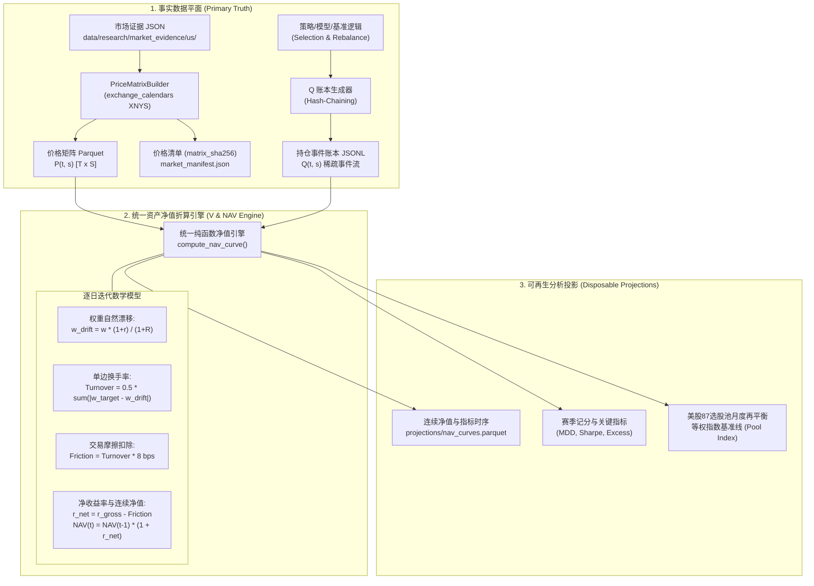

# Racetrack 最小技术栈与资产净值引擎技术规范 (Phase 1 Spec)
## Racetrack Minimal Stack & NAV Engine Technical Specification

- **状态**: **草案 / 实施规范 (Phase 1 Specification)**
- **规划基准**: Track B Phase 1 (#1306) · 关联 RFC [`docs/product/racetrack_vision_2026-10-27.md`](file:///D:/Documents/GitHub/alphaengine/docs/product/racetrack_vision_2026-10-27.md) §4, §10, §11.2
- **权威层级**: 下位规范，受制于 [`AGENTS.md`](file:///D:/Documents/GitHub/alphaengine/AGENTS.md)、ADR-0003 与 [ADR-0005](file:///D:/Documents/GitHub/alphaengine/docs/architecture/adr-0005-point-in-time-information-state-semantics.md)
- **运行铁律**: `research_only=true` · `trade_ready=false` · 纯函数式与单一推导权威 · 绝不添加重复数据库/常驻调度器 · 绝对隔离个人实盘账户隐私

---

## 1. 架构定位与落地目标 (Architecture Context & Objectives)

### 1.1 背景与系统定位
依据 PR #1306《Alpha Engine Racetrack Vision (2026-10-27)》，Alpha Engine 投研基础设施正在由分散的孤立回测脚本，向统一的**赛道记分板 (Racetrack Scoreboard)** 范式演进。在赛道模型中：
- 策略、指标与模型均具象化为参赛的 **Runner**；
- 评价维度摒弃单一区间的单次历史回测，升级为基于真实交易日历的连续净值演化（1个月、3个月、6个月、1年窗口）、月度收益排名与赛季积分制度；
- 系统的中心视图是**以 1.0 为统一归一起点的连续净值曲线（NAV Curve）**。

### 1.2 Phase 1 Minimal Stack 范围与边界
为杜绝“先搭庞大基础设施、后发现无实际使用场景”的过度设计，Phase 1 严格遵循 §11.2 落地顺序要求，实现紧凑的**最小技术栈 (Minimal Stack)**：
1. **只存储原生事实量**：仅持久化市场价格矩阵 $P(t, s)$ 与稀疏持仓事件账本 $Q(t, s)$。净值、持仓权重、换手率、交易摩擦与评价指标均作为衍生量，按需纯函数式推导，绝不作为独立事实量持久化，杜绝衍生量与原始量失真漂移；
2. **纯文件与内存计算**：底层存储采用不可变 Parquet 与 JSONL，计算引擎绑定 Polars 与 Apache Arrow，严禁引入任何外置数据库（如 DuckDB Server、ClickHouse、第二套 SQLite 等）；
3. **可复现与防篡改**：每个原生与衍生制品绑定密码学内容哈希清单（Manifest）与哈希链（Hash Chain），删除所有衍生文件后重跑脚本能 100% 字节级重现；
4. **零实盘敏感信息暴露**：研究账本严格排除股数（shares）、资金规模（cost/capital）、券商信息（broker）及实盘成交盈亏，只承载相对目标权重。



---

## 2. P(t, s) 市场价格矩阵技术规范 (Market Price Matrix)

### 2.1 坐标轴与边界定义
价格矩阵 $P(t, s)$ 是一个二维时序特征面板，维度严格锁定为 $T \times S$：

#### 1. 时间轴 $T$ (Time Axis)
- **交易日历权威**：必须接入 `exchange_calendars` 库提供的交易所官方日历，美股统一绑定 `XNYS`（New York Stock Exchange），A股统一绑定 `XSHG`（Shanghai Stock Exchange）；
- **时间范围定义**：区间 $[t_{start}, t_{end}]$ 严格由日历有效会话序列组成，即 $T = \{t_0, t_1, \dots, t_N\} = \text{sessions\_in\_range}(t_{start}, t_{end})$；
- **时区与格式规范**：会话标签严格格式化为 `YYYY-MM-DD` 字符串（例如 `"2026-10-26"`），对应的日内价格锚定为纽约收盘时间（16:00 EST / 21:00 UTC）；
- **会话连续性与断点检验**：严禁自行跳过非周末假日或填补周末虚假交易日；任何位于交易所休市日的行情请求必须被 Fail-Closed 拦截。

#### 2. 资产轴 $S$ (Asset Axis)
- **选股池候选标的 (Candidates)**：严格绑定治理版本 `configs/research_universes/us_selected_equities_v2.yaml` 声明的 **87 只美股候选股票**；
- **基准参考标的 (Reference)**：严格绑定 `configs/pools/reference_instrument_registry_v1.yaml` 声明的比较基准 **`QQQ`**（Invesco QQQ Trust）；
- **联合资产空间**：$S = S_{candidates} \cup \{ \text{QQQ} \}$，标的总数 $|S| = 87 + 1 = 88$；
- **标的隔离不变式**：候选池标的与参考标的角色分离，参考标的 `QQQ` 仅作为外生环境对照，严禁被任何多因子策略当作候选股票买入。

### 2.2 价格源与复权模型 (Price Source & Total Return Model)
- **数据源路径**：从权威市场证据存储读取：
  `data/research/market_evidence/us/symbols/{symbol}.json`
- **字段提取**：读取 JSON 内 `bars` 数组的 `close` 字段及对应交易日 `time`；
- **复权模型定义（分红再投资总收益价）**：
  依据 §11.1 决策，采用**分红再投资总收益模型 (Adjusted Total Return Price)**：
  - 现金分红与送转股统一折算并入复权价格（已在 `market_evidence` 构建阶段完成）；
  - 资产在持有期内的收益率直接体现为复权价格的相对变动：
    $$r_{i, t} = \frac{P_{adj}(t, i)}{P_{adj}(t-1, i)} - 1$$
  - 该设定消除了在投研阶段逐笔跟踪分红到账、除息日现金挂账与再买入碎股的系统复杂度，同时确保长期复利计算的学术与实盘严谨性。
- **数据完整性与 Fail-Closed 规则**：
  - 缺失价格：若标的 $s$ 在某交易日 $t$ 停牌或数据缺失，矩阵对应单元格必须为 `NaN`（或 `null`），**严禁使用上一个有效价格进行静默前向填充 (forward-fill)**，更严禁将其强转为 0；
  - 上市前处理：若标的在 $t$ 日尚未上市（$t < t_{list}$），对应价格为 `NaN`；任何试图在 $t < t_{list}$ 时对该标的分配非零权重的策略将被引擎直接阻断（抛出 `LifecycleIntegrityError`）。

### 2.3 物理存储与 Parquet 规范
矩阵在落盘时采用扁平化宽表（Wide-Table）或长表（Long-Table）分区 Parquet。在 Minimal Stack 中，推荐采用以交易日为行索引、标的为列的宽表结构（2,500 行 $\times$ 88 列，内存占用低于 2 MB）：

```text
data/racetrack/prices/
└── us87_qqq_matrix_v1.parquet
```

- **Arrow Schema 声明**：
  - `session`: `DataType::Utf8` (或 `Date32`), Primary Key, 升序排序无重复；
  - `AAPL`: `DataType::Float64`
  - `MSFT`: `DataType::Float64`
  - ... (共 87 只选股池标的)
  - `QQQ`: `DataType::Float64`

### 2.4 行情矩阵清单规范 (Market Price Manifest Schema)
伴随 `us87_qqq_matrix_v1.parquet` 一同落盘并接受版本控制的清单文件：
`data/racetrack/prices/us87_qqq_matrix_v1.manifest.json`

```json
{
  "$schema": "https://json-schema.org/draft/2020-12/schema",
  "title": "RacetrackPriceMatrixManifest",
  "type": "object",
  "required": [
    "schema_version",
    "matrix_id",
    "market",
    "universe_pool_id",
    "reference_symbol",
    "calendar",
    "start_session",
    "end_session",
    "total_sessions",
    "total_assets",
    "matrix_sha256",
    "created_at_utc",
    "source_evidence_hashes"
  ],
  "properties": {
    "schema_version": { "type": "string", "enum": ["1.0"] },
    "matrix_id": { "type": "string", "example": "us87_qqq_prices_daily_v1" },
    "market": { "type": "string", "enum": ["us"] },
    "universe_pool_id": { "type": "string", "enum": ["us_selected_equities_v2"] },
    "reference_symbol": { "type": "string", "enum": ["QQQ"] },
    "calendar": { "type": "string", "enum": ["XNYS"] },
    "start_session": { "type": "string", "format": "date" },
    "end_session": { "type": "string", "format": "date" },
    "total_sessions": { "type": "integer", "minimum": 1 },
    "total_assets": { "type": "integer", "enum": [88] },
    "matrix_sha256": { 
      "type": "string", 
      "pattern": "^[a-f0-9]{64}$",
      "description": "SHA-256 of the canonical parquet bytes" 
    },
    "created_at_utc": { "type": "string", "format": "date-time" },
    "source_evidence_hashes": {
      "type": "object",
      "additionalProperties": { "type": "string", "pattern": "^[a-f0-9]{64}$" },
      "description": "Mapping of symbol -> sha256 of data/research/market_evidence/us/symbols/{symbol}.json"
    }
  }
}
```

---

## 3. Q(t, s) 持仓事件账本技术规范 (Holdings Event Ledger)

### 3.1 稀疏事件流格式 (Sparse JSONL Event Stream)
依据 §4 设计原则，持仓矩阵 $Q(t, s)$ 在物理存储上必须保持**稀疏事件流 (Sparse Event Stream)**。
- 策略不会在每个交易日都调整所有标的仓位；
- 存储路径：`data/racetrack/ledgers/{runner_id}_v{runner_version}.jsonl`；
- 文件内的每一行都是一个合法的 JSON 调仓事件对象；在未发生再平衡决策的交易日，账本中不产生记录；
- 当计算引擎需要密集持仓面板 $Q(t, s)$ 时，通过前向填充（Holdings Carry-Forward）将稀疏事件在内存中展开。

### 3.2 严密 Schema 契约 (Ledger Event Schema Contract)

每个调仓事件必须严格满足以下 JSON Schema 校验：

```json
{
  "$schema": "https://json-schema.org/draft/2020-12/schema",
  "title": "RacetrackLedgerEvent",
  "type": "object",
  "required": [
    "event_id",
    "parent_hash",
    "timestamp_utc",
    "effective_session",
    "runner_id",
    "runner_version",
    "target_weights",
    "cash_weight",
    "reason",
    "event_hash"
  ],
  "properties": {
    "event_id": {
      "type": "string",
      "description": "Unique identifier for this rebalance event (UUIDv4)"
    },
    "parent_hash": {
      "type": "string",
      "pattern": "^[a-f0-9]{64}$",
      "description": "SHA-256 hash of the immediately preceding event. Genesis event must use '0'*64."
    },
    "timestamp_utc": {
      "type": "string",
      "format": "date-time",
      "description": "Physical time when the strategy made the decision"
    },
    "effective_session": {
      "type": "string",
      "format": "date",
      "description": "Trading calendar session date (YYYY-MM-DD) when these target weights become effective"
    },
    "runner_id": {
      "type": "string",
      "pattern": "^[a-z0-9_]+$",
      "description": "Unique identifier of the strategy or runner"
    },
    "runner_version": {
      "type": "string",
      "description": "SemVer or version tag of the runner"
    },
    "target_weights": {
      "type": "object",
      "additionalProperties": {
        "type": "number",
        "minimum": 0.0,
        "maximum": 1.0
      },
      "description": "Dictionary of symbol -> target fraction of total portfolio value. Sum must be <= 1.0."
    },
    "cash_weight": {
      "type": "number",
      "minimum": 0.0,
      "maximum": 1.0,
      "description": "Target cash fraction. Must strictly equal 1.0 - sum(target_weights.values())."
    },
    "reason": {
      "type": "string",
      "description": "Human-readable thesis-bound rationale for the rebalance"
    },
    "event_hash": {
      "type": "string",
      "pattern": "^[a-f0-9]{64}$",
      "description": "SHA-256 hash of canonical serialization of this event (excluding event_hash field itself)"
    }
  }
}
```

### 3.3 哈希链防篡改与锚定机制 (Hash-Chaining & Anchoring)

1. **创世事件 (Genesis Event)**：
   每个 Runner 账本的第一个事件必须声明：
   $$\text{parent\_hash} = \text{"0000000000000000000000000000000000000000000000000000000000000000"} \quad (64 \text{ zeros})$$
2. **规范化事件哈希 (Canonical Event Hash)**：
   计算 `event_hash` 时，必须提取当前事件中除 `event_hash` 之外的所有 9 个字段，键名按 ASCII 字典序排序，采用无多余空格的紧凑 JSON 格式（`json.dumps(obj, sort_keys=True, separators=(',', ':'))`），编码为 UTF-8 字节后计算 SHA-256：
   $$\text{event\_hash}_k = \text{SHA-256}\Big(\text{CanonicalJSON}\big(\text{Event}_k \setminus \{\text{event\_hash}\}\big)\Big)$$
3. **链式连续性校验**：
   对于账本中第 $k$ 个事件（$k \ge 1$），必须满足：
   $$\text{Event}_k.\text{parent\_hash} \equiv \text{Event}_{k-1}.\text{event\_hash}$$
   任何篡改历史权重、调仓日期或理由的行为，将导致后续所有节点的哈希链断裂，校验器立即 Fail-Closed 熔断。
4. **末梢锚定 (Tip Anchoring)**：
   每次策略运行结算或正式发布时，将在 Runner Manifest 中固化当前账本的末梢哈希 `ledger_tip_hash` 和总行数 `ledger_event_count`。防止发生历史截断（Truncation Attack）或隐式重放。

### 3.4 绝对隐私隔离与合规边界 (Strict Privacy Isolation)
依据 §7、§10 铁律及 ADR-0004 规范，投研赛道账本**绝对禁止**混入任何实盘个人账户敏感信息：
- **禁止包含的敏感字段**：
  - `shares` / `qty` / `lots`（持仓股数或交易股数）
  - `total_cost` / `cost_basis` / `cash_balance`（绝对资金规模或现金余额）
  - `broker` / `brokerage_account` / `account_id`（券商名称或个人账号）
  - `executed_price` / `execution_fee` / `commission_paid`（实盘成交单价或手续费扣款）
  - `realized_pnl` / `unrealized_pnl`（已实现/未实现个人盈亏金额）
- **边界校验机制**：
  账本加载器（`LedgerReader`）内置静态字段白名单断言。只要在 JSONL 任何一行检测到上述敏感关键字，立即抛出 `PrivacyViolationError`，阻断后续所有净值折算。

---

## 4. 资产价值与统一净值折算引擎数学规范 (V & NAV Engine)

统一净值引擎以纯函数方式运作，输入行情矩阵 $P(t, s)$、事件账本 $Q(t, s)$ 与交易摩擦参数 $\text{friction\_rate}$，输出每日净值时序与指标集。

### 4.1 初始状态与价值锚定
- 设定统一初始回测/赛季起点交易日为 $t_0$；
- 初始资产组合名义总价值归一化为：
  $$V(t_0) = 1.00000000, \quad \text{NAV}(t_0) = 1.00000000$$
- 若在 $t_0$ 策略尚未分配仓位，则全额持有现金：$w_{cash, t_0} = 1.0, w_{i, t_0} = 0.0$。

### 4.2 逐日权重漂移数学模型 (Asset Weight Drift Dynamics)
在真实交易世界中，由于组合内各标的价格每日涨跌幅不同，收盘时的实际资产权重会偏离买入时的目标权重。引擎必须显式模拟这一**权重自然漂移**过程。

设交易日为 $t$（持有期为 $(t-1, t]$，对应 $t-1$ 收盘至 $t$ 收盘）：
1. **各资产日收益率**：
   $$r_{i, t} = \frac{P(t, i)}{P(t-1, i)} - 1, \quad \forall i \in S$$
   现金日收益率 $r_{cash, t} \equiv 0$（或按年化无风险利率折算，默认取 0）。
2. **组合当日毛收益率 (Gross Return)**：
   $$r_{gross, t} = \sum_{i \in S} w_{i, t-1}^{target\_or\_prior} \cdot r_{i, t}$$
   其中 $w_{i, t-1}^{target\_or\_prior}$ 为在 $t-1$ 收盘时已确定的持有权重。
3. **收盘资产权重自然漂移 (Drifted Weight)**：
   收盘后，资产 $i$ 价值占组合总价值的最新比重漂移为：
   $$w_{i, t}^{drift} = \frac{w_{i, t-1}^{target\_or\_prior} \cdot (1 + r_{i, t})}{1 + r_{gross, t}}$$
   收盘现金漂移权重为：
   $$w_{cash, t}^{drift} = \frac{w_{cash, t-1}^{target\_or\_prior}}{1 + r_{gross, t}} = 1.0 - \sum_{i \in S} w_{i, t}^{drift}$$
   易证：$\sum_{i \in S} w_{i, t}^{drift} + w_{cash, t}^{drift} \equiv 1.0$。

### 4.3 单边换手率定义与守恒定律 (One-Sided Turnover Definition)
在交易日 $t$ 收盘时，若策略根据最新行情与模型信号发出调仓决策，生成新的目标权重 $w_{i, t}^{target}$ 与 $w_{cash, t}^{target}$（生效于当日收盘执行）：
- **单边换手率 (Turnover Rate)** 严格定义为**新目标权重相对于漂移后现有权重的绝对差值之和的一半**：
  $$\text{Turnover}_t = \frac{1}{2} \left( \sum_{i \in S} \left| w_{i, t}^{target} - w_{i, t}^{drift} \right| + \left| w_{cash, t}^{target} - w_{cash, t}^{drift} \right| \right)$$
- **性质与守恒性**：
  - 若当日无调仓事件，则 $w_{i, t}^{target} \equiv w_{i, t}^{drift}$，换手率 $\text{Turnover}_t = 0.0$；
  - 初始建仓时，从 100% 现金建仓到 100% 股票仓位，换手率 $\text{Turnover}_{t_0} = \frac{1}{2}(|1.0 - 0.0| + |0.0 - 1.0|) = 1.0$；
  - 仅股票之间调仓（现金保持 0），例如将 50% 仓位由 A 标的换到 B 标的，换手率 $\text{Turnover}_t = \frac{1}{2}(|0 - 0.5| + |0.5 - 0| + |0 - 0|) = 0.5$（即单边换手 50%）。

### 4.4 交易摩擦模型 (Transaction Friction Model)
调仓产生的交易成本（佣金、印花税/SEC Fee、滑点与买卖价差）按单边换手率线性计提：
$$\text{Friction}_t = \text{Turnover}_t \times \text{friction\_rate}$$
- **基准费率 (Baseline)**：默认单边 $\text{friction\_rate} = 8 \text{ bps} = 0.0008$（单边万分之八，涵盖 3 bps 佣金与 5 bps 冲击/规费）；
- **参数敏感性支持 (Sensitivity Modes)**：
  - `friction_rate = 0.0` (0 bps)：学术与理想无摩擦收益上限，用于评估因子纯 Alpha；
  - `friction_rate = 0.0008` (8 bps)：生产与竞赛标准成本；
  - `friction_rate = 0.0015` (15 bps)：高摩擦压力测试（用于微盘股或极端市场波动期）。

### 4.5 净收益率与连续净值迭代 (Net Return & Continuous NAV)
1. **逐日净收益率**：
   $$r_{net, t} = r_{gross, t} - \text{Friction}_t$$
2. **连续净值更新**：
   $$\text{NAV}(t) = \text{NAV}(t-1) \cdot (1 + r_{net, t})$$
   对所有 $t \in \{t_1, t_2, \dots, t_N\}$ 递归计算，生成单调连续的投研净值曲线。

### 4.6 核心绩效指标计算规范 (Key Performance Metrics)

#### 1. 连续最大回撤 (Continuous Maximum Drawdown, MDD)
对任意交易日 $t \in T$：
$$\text{Peak}(t) = \max_{t_0 \le \tau \le t} \text{NAV}(\tau)$$
$$\text{Drawdown}(t) = \frac{\text{Peak}(t) - \text{NAV}(t)}{\text{Peak}(t)}$$
$$\text{MDD}(t) = \max_{t_0 \le \tau \le t} \text{Drawdown}(\tau)$$
最终全周期最大回撤为 $\text{MDD}(t_N)$，以负数百分比形式呈现。

#### 2. 年化复合收益率与超额收益 (CAGR & Annualized Excess Return vs QQQ)
设总交易日数为 $N$（标准年化系数取美股一年 252 个交易日）：
$$\text{CAGR}_{runner} = \left( \text{NAV}_{runner}(t_N) \right)^{\frac{252}{N}} - 1$$
$$\text{CAGR}_{QQQ} = \left( \text{NAV}_{QQQ}(t_N) \right)^{\frac{252}{N}} - 1$$
$$\text{Excess Return} = \text{CAGR}_{runner} - \text{CAGR}_{QQQ}$$

#### 3. 年化夏普比率 (Annualized Sharpe Ratio)
设无风险日利率为 $r_{f, t}$（默认取 0.0，或按年化 4% 取 $r_{f, t} = (1 + 0.04)^{1/252} - 1 \approx 0.000155$）：
$$\text{Excess Daily Return}: d_t = r_{net, t} - r_{f, t}$$
$$\bar{d} = \frac{1}{N} \sum_{t=1}^N d_t, \quad \sigma_d = \sqrt{\frac{1}{N-1} \sum_{t=1}^N (d_t - \bar{d})^2}$$
$$\text{Sharpe} = \sqrt{252} \cdot \frac{\bar{d}}{\sigma_d}$$

---

## 5. 自建股票池指数规范：美股 87 等权基准 (US 87 Equal-Weighted Pool Index)

### 5.1 指数定位与治理原则
依据 PR #1306 §2 与 §11.2 第 3 步，美股 87 选股池拥有其专属的自建指数基准（Pool Index）：
- **赛道内部第一参考基准线**：直接衡量选股池股票本身的平均表现。任何选股模型或轮动策略，若跑不赢该选股池等权基准，则证明其模型并未产生正向选股 Alpha，仅仅是吃到了股票池本身的 Beta 红利；
- **双基准对照体系**：
  - 外部大盘基准：`QQQ`（纳斯达克100 ETF）；
  - 内部股票池基准：`US87_EW`（美股 87 选股池月度再平衡等权指数）。

### 5.2 资产池与成分股约束
- **成分股集合**：严格对应 `configs/research_universes/us_selected_equities_v2.yaml` 声明的 87 只标的；
- **成分股数量**：$M = 87$；
- **调整规则**：股票池大小首先被冻结；任何成分股的增删都必须通过正式治理发布新版本选股池配置，严禁策略私自调整成分。

### 5.3 月度再平衡与权重规则
1. **再平衡触发日**：
   每个自然月的**第一个交易日**（基于 `exchange_calendars` XNYS 判定）：
   $$t_{reb} \in \{t \in T \mid \text{month}(t) \ne \text{month}(t-1)\}$$
2. **目标权重设定**：
   在 $t_{reb}$ 收盘时，执行严格等权再平衡：
   $$w_{i, t_{reb}}^{target} = \frac{1}{M} = \frac{1}{87} \approx 0.01149425, \quad \forall i \in \text{US 87}$$
   $$w_{cash, t_{reb}}^{target} = 0.0$$
3. **月内自然漂移 (Intra-Month Drift)**：
   在自然月内的其余交易日（$t \ne t_{reb}$），指数**不进行任何主动调仓**：
   - 目标权重紧随价格波动自然漂移：$w_{i, t}^{target} = w_{i, t}^{drift}$；
   - 月内非再平衡日的单边换手率严格为 $\text{Turnover}_t = 0.0$；
   - 杜绝日度高频再平衡引起的虚假交易摩擦损耗。
4. **异常停牌与突发退市处理 (Delisting & Suspension Invariants)**：
   - 若某标的在月内停牌，价格维持前一日收盘价，权重自然参与分母归一；
   - 若发生突发退市或停牌终止，标的按最后有效价格强平变现为现金，现金被动留存组合中直至下一个自然月首个交易日再平衡，严禁在月内临时调入替换标的。

### 5.4 统一折算与对等摩擦
- 选股池指数基准同样作为标准的虚拟 Runner 运行，其调仓事件流自动输出至 `data/racetrack/ledgers/benchmark_us87_ew_v1.jsonl`；
- 同样通过第 4 节定义的统一资产净值折算引擎（V & NAV Engine）执行计算；
- 在每个自然月首个交易日，等权再平衡同样扣除单边 8 bps 的换手摩擦，确保与参赛策略面对完全对等、公平的摩擦环境。

---

## 6. 系统实现架构与工程流水线 (Implementation Architecture)

### 6.1 纯函数式数据流水线
整个 Minimal Stack 由无状态纯函数构成，避免任何持久化类实例缓存造成的隐蔽状态污染：

```python
# 概念接口蓝图 (Conceptual Function Signatures)

def build_market_price_matrix(
    market: str,
    universe_config_path: Path,
    reference_config_path: Path,
    calendar_name: str,
    output_dir: Path,
) -> tuple[Path, Path]:
    """读取市场证据 JSON，对齐 exchange_calendars，输出 Parquet 矩阵与 Manifest JSON。
    
    Returns:
        (parquet_path, manifest_path)
    """
    ...

def validate_ledger_hash_chain(ledger_path: Path) -> dict[str, Any]:
    """逐行校验 JSONL 事件流哈希链完整性与隐私合规性，返回末梢哈希及事件总数。"""
    ...

def compute_nav_engine(
    price_matrix_path: Path,
    ledger_path: Path,
    friction_bps: float = 8.0,
    risk_free_rate_annual: float = 0.0,
) -> tuple[pl.DataFrame, dict[str, float]]:
    """以 Polars 矩阵运算执行资产价值与净值折算，返回逐日 NAV 时序与 KPI 总结字典。"""
    ...

def generate_pool_index_ledger(
    universe_config_path: Path,
    calendar_name: str,
    start_session: str,
    end_session: str,
    output_path: Path,
) -> Path:
    """生成美股 87 月度等权再平衡基准事件流 JSONL。"""
    ...
```

### 6.2 目录与文件布局规范
```text
data/racetrack/
├── prices/
│   ├── us87_qqq_matrix_v1.parquet          # 88 列不可变复权价格矩阵
│   └── us87_qqq_matrix_v1.manifest.json    # 包含 matrix_sha256 与各标的 source sha256
├── ledgers/
│   ├── benchmark_us87_ew_v1.jsonl          # 自建等权基准事件流
│   └── {runner_id}_v{version}.jsonl        # 各策略参赛事件流
└── projections/
    ├── nav_timeseries_v1.parquet           # 统一折算后的每日 NAV/回撤/换手时序宽表
    └── racetrack_scoreboard_v1.json        # 赛道记分板汇总 (窗口收益、夏普、超额、月度排名)
```

---

## 7. 负面测试与边界验证矩阵 (Verification & Negative Matrix)

为确保落地代码的机构级鲁棒性，Phase 1 实施必须配套以下 8 项独立测试：

| 测试用例 ID | 测试类别 | 输入条件 / 场景 | 预期断言与阻断行为 |
| :--- | :--- | :--- | :--- |
| **TEST-RT-01** | 确定性重现 | 两次独立运行净值引擎折算同一账本 | 输出的逐日 NAV 浮点数组与统计指标 100% 位级相等 (`np.testing.assert_allclose`)。 |
| **TEST-RT-02** | 日历边界检验 | 传入跨周末、交易所休市日或格式错误的 `effective_session` | 引擎立即抛出 `CalendarSessionError`，拒绝生成或折算该事件。 |
| **TEST-RT-03** | 选股池越界拦截 | 事件账本的 `target_weights` 包含不在 US 87 池中的非法标的 | 校验器抛出 `UnauthorizedAssetError`，严密 fail-closed。 |
| **TEST-RT-04** | 权重超限拦截 | 事件账本的 $\sum w_i > 1.000001$ 或出现负权重（空头） | 校验器抛出 `WeightConstraintError`，拒绝载入。 |
| **TEST-RT-05** | 隐私泄露防御 | 事件账本中注入 `shares`, `total_cost`, `broker` 等字段 | 静态扫描立即抛出 `PrivacyViolationError`，阻断流水线。 |
| **TEST-RT-06** | 哈希链防篡改 | 手动篡改中间某一事件的 `target_weights` 或 `reason` | 后续事件哈希校验不匹配，抛出 `HashChainIntegrityError`。 |
| **TEST-RT-07** | 价格缺失阻断 | 策略持有某标的，但该标的在 $t$ 日价格为 `NaN`（突发停牌无价） | 引擎禁止前向填充，抛出 `MissingPriceDataError`，进入降级/阻塞处理。 |
| **TEST-RT-08** | 等权指数漂移验证 | 检查美股 87 等权基准在自然月中期的换手率与权重漂移 | 验证月内交易日 $\text{Turnover} \equiv 0$，权重随收益率波动发生标准漂移。 |

---

## 8. 实施总结与交付标准 (DoD)

1. **规范文档封存**：本规范作为 Phase 1 Minimal Stack 的唯一架构蓝图，受控保存于 `docs/architecture/racetrack_minimal_stack_spec.md`；
2. **PR #1306 对齐**：在 `docs/product/racetrack_vision_2026-10-27.md` 追加第 12 节，提供指向本规范的链接与核心决策摘要；
3. **实现推进准入**：后续代码实现（Polars 矩阵构建、哈希链账本与 NAV 引擎）必须严格逐条满足本规范所列之公式与 Schema，不得发明未经规范约定的中间文件或状态库。
