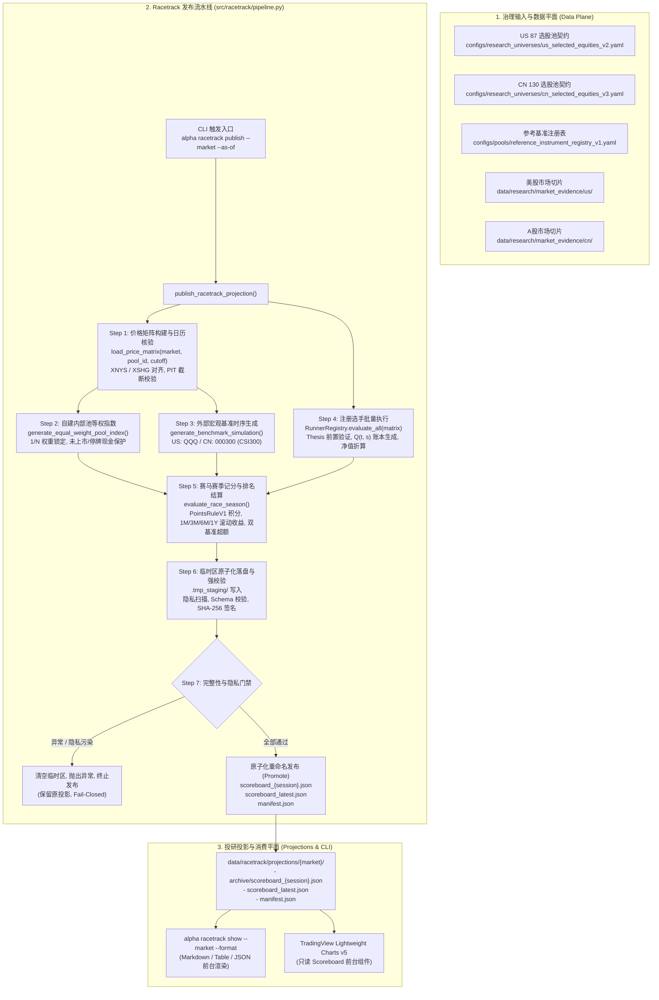
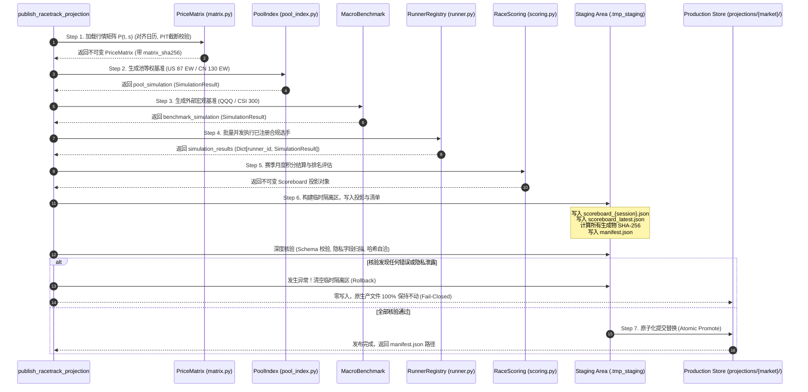
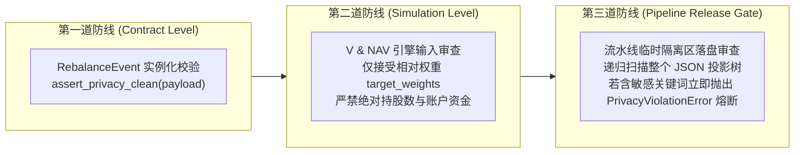

# Racetrack 双市场基准与自维护发布流水线技术架构规范 (Phase 3 Spec)
## Racetrack Dual-Market Benchmarks & Self-Maintaining Publish Pipeline Technical Specification

- **状态**: **草案 / 实施规范 (Phase 3 Specification)**
- **规划基准**: Track B Phase 3 (#1306) · 关联 RFC [`docs/product/racetrack_vision_2026-10-27.md`](file:///D:/Documents/GitHub/alphaengine/docs/product/racetrack_vision_2026-10-27.md) §11.2 第 3 & 4 步, §12, §13, §14
- **前置依赖**: Phase 1 Minimal Stack [`docs/architecture/racetrack_minimal_stack_spec.md`](file:///D:/Documents/GitHub/alphaengine/docs/architecture/racetrack_minimal_stack_spec.md) · Phase 2 Runner & Scoring [`docs/architecture/racetrack_runner_scoring_spec.md`](file:///D:/Documents/GitHub/alphaengine/docs/architecture/racetrack_runner_scoring_spec.md)
- **权威层级**: 下位规范，受制于 [`AGENTS.md`](file:///D:/Documents/GitHub/alphaengine/AGENTS.md)、ADR-0003、[ADR-0004](file:///D:/Documents/GitHub/alphaengine/docs/adr/0004-deterministic-release-contract-ci.md) 与 [ADR-0005](file:///D:/Documents/GitHub/alphaengine/docs/architecture/adr-0005-point-in-time-information-state-semantics.md)
- **运行铁律**: `research_only=true` · `trade_ready=false` · 双基准正交解耦 · 严格原子化落盘 (Fail-Closed) · 零外置调度器与无数据库污染 · 绝对隔离个人实盘隐私

---

## 1. 架构定位与系统边界 (Context & Operating Principles)

### 1.1 从“赛马竞技模型”到“双市场自动化投研基础设施”
在 Phase 1 与 Phase 2 中，Alpha Engine 分别建立了：
1. **Phase 1 (Minimal Stack)**：原生价格矩阵 $P(t, s)$、稀疏事件账本 $Q(t, s)$、统一资产净值折算引擎（V & NAV Engine）以及美股 87 月度等权选股池基准（US 87 EW）；
2. **Phase 2 (Runner & Scoring)**：选手准入契约（`RunnerContract`）、前置投资假设审核门禁（`ThesisMissingError`）、动态注册表（`RunnerRegistry`）、自然月赛季积分机制（`PointsRuleV1`）以及前台只读记分板契约（`Scoreboard`）。

Phase 3 依据 PR #1306《Alpha Engine Racetrack Vision (2026-10-27)》§11.2 第 3 步（Pool indices versus benchmarks）与第 4 步（Daily self-maintenance），解决投研基础设施从“单市场单次执行”迈向“双市场自动化全生命周期自维护”的核心瓶颈：
- **构建成熟的双市场基准体系 (Dual Market Benchmark Architecture)**：不仅支持美股（US 87 EW + QQQ），而且原生支持 A 股市场（CN 130 EW + CSI 300），确立严格的选股池等权治理不变式与符号对齐解析；
- **实现每日自维护与发布流水线 (`src/racetrack/pipeline.py`)**：单命令一键驱动数据核验、基准推导、选手并发回放、赛季记分、前台投影生成与密码学清单签署；
- **确立严格的原子化事务与 Fail-Closed 机制**：任何步骤异常或隐私检出，严禁脏写发布，旧投影不受丝毫污染；
- **打通 CLI 终端交互界面 (`src/cli/main.py`)**：提供极简且确定性的 `alpha racetrack publish` 与 `alpha racetrack show` 命令行接口。

### 1.2 核心设计铁律 (System Invariants)
1. **双基准正交解耦 (Dual Benchmark Orthogonality)**：
   每个市场必须同时提供**外部宏观大盘基准**（美股 QQQ、A股 CSI 300）与**内部选股池等权基准**（美股 US 87 EW、A股 CN 130 EW）。
   - 选手相对于宏观基准的超额收益反映策略跑赢大市的能力（Beta Exposure）；
   - 选手相对于内部选股池等权基准的超额收益反映策略在既定股票池中的纯选股阿尔法能力（Pure Selection Alpha）。二者必须正交计算、严禁混淆。
2. **等权基准守恒与现金槽保护 (Cash Slot Protection Invariant)**：
   选股池等权基准指数的成份股总数严格锁定为治理声明的基数 $N$（美股 87，A 股 130），单只标的基准目标权重固定为 $1/N$。
   - 若某标的在调仓日未上市（Pre-IPO）或停牌缺失数据，其 $1/N$ 份额**必须以现金持有 ($w_{cash} = N_{unlisted} / N$)**；
   - 严禁将未上市或缺失标的的权重静默重新均摊给其他活跃标的，杜绝权重虚高与基准失真。
3. **严格原子化与 Fail-Closed 防脏写 (Atomic Landing & Fail-Closed Invariant)**：
   发布流水线的所有落盘动作必须在临时隔离区（Staging Area）完成并全量校验（含 SHA-256 核验、Schema 校验、隐私安全终审）；
   - 任何一步发生异常，直接中断并清空临时区，原生产投影完整保留；
   - 仅当全部产物无误时，执行原子化替换，保证前台读者永远读取到完整一致的投影数据。
4. **位级确定性与幂等性 (Bit-Level Idempotency)**：
   在相同的行情切片、选手逻辑与截止日输入下，多次重复运行流水线必须产生位级相同（Bit-Identical）的 JSON 输出与 SHA-256 签名，严禁引入非受控随机量或未归一化浮点漂移。
5. **绝对隔离实盘个人隐私 (Zero Account Privacy Invariant)**：
   严遵 [ADR-0004](file:///D:/Documents/GitHub/alphaengine/docs/adr/0004-deterministic-release-contract-ci.md) 与 ADR-0005，投研赛道流水线各环节绝对严禁混入个人实盘账户敏感字段（如 `shares`, `cost_basis`, `broker`, `account_id`, `pnl` 等）。流水线落盘前进行递归式终审拦截。

### 1.3 整体系统架构全景 (System Architecture Flow)



---

## 2. 双市场基准体系架构规范 (Dual Market Benchmark Architecture)

### 2.1 双市场基准矩阵定义
系统确立美股（`us`）与 A 股（`cn`）两大独立闭环的市场空间，任何跨市场的标的混淆或日历交叉均被底层物理隔离：

| 维度 | 美股市场 (`market="us"`) | A 股市场 (`market="cn"`) |
| :--- | :--- | :--- |
| **官方交易日历** | `XNYS` (New York Stock Exchange) | `XSHG` (Shanghai Stock Exchange) |
| **选股池契约** | `configs/research_universes/us_selected_equities_v2.yaml` | `configs/research_universes/cn_selected_equities_v3.yaml` |
| **候选标的基数** | $N_{declared} = 87$ 只美股标的 | $N_{declared} = 130$ 只 A 股标的 |
| **内部池等权基准** | `US 87 EW Pool Index` (`benchmark_us_selected_equities_v2_ew`) | `CN 130 EW Pool Index` (`benchmark_cn_selected_equities_v3_ew`) |
| **单标的目标权重** | $w_i = 1 / 87 \approx 0.01149425$ | $w_i = 1 / 130 \approx 0.00769231$ |
| **外部宏观基准** | `QQQ` (Invesco QQQ Trust ETF) | `000300` / `000300.SH` (沪深300指数 CSI 300) |
| **参考标的契约** | `configs/pools/reference_instrument_registry_v1.yaml` (`us.instruments.QQQ`) | `configs/pools/reference_instrument_registry_v1.yaml` (`cn.instruments.CSI300`) |
| **行情切片目录** | `data/research/market_evidence/us/` | `data/research/market_evidence/cn/` |
| **单边调仓摩擦** | 8 bps ($0.0008$) | 8 bps ($0.0008$) |

### 2.2 选股池等权基准治理不变式与数学模型
选股池等权基准指数通过 [`src/racetrack/pool_index.py`](file:///D:/Documents/GitHub/alphaengine/src/racetrack/pool_index.py) 的 `generate_equal_weight_pool_index()` 纯函数生成，严格遵守以下数学公理：

#### 1. 固定基数与份额锁定公理
令候选池声明标的集合为 $S_{pool} = \{s_1, s_2, \dots, s_N\}$，基数 $|S_{pool}| = N_{declared}$。每个标的的基准份额被刚性锁定：
$$w_{target, i} = \frac{1}{N_{declared}}, \quad \forall i \in S_{pool}$$

#### 2. 未上市与停牌现金槽保护公理 (Cash Slot Protection)
在任意调仓交易日 $t$，系统审查标的有效性。令活跃可交易标的集合为 $S_{active}(t) = \{s \in S_{pool} \mid P(t, s) \neq \text{NaN}\}$，不可交易标的集合为 $S_{inactive}(t) = S_{pool} \setminus S_{active}(t)$。
不可交易数量为 $N_{unlisted}(t) = |S_{inactive}(t)|$。
- **严禁重新均摊**：不可交易标的的槽位**绝对禁止**均摊给活跃标的（即活跃标的权重绝不允许膨胀为 $1 / |S_{active}(t)|$）；
- **现金槽吸收**：不可交易标的对应的权重严格归入现金：
  $$w_{cash}(t) = \frac{N_{unlisted}(t)}{N_{declared}}$$
  活跃标的权重保持不变：
  $$w_i(t) = \frac{1}{N_{declared}}, \quad \forall i \in S_{active}(t)$$
  权重和严格满足：
  $$\sum_{i \in S_{active}(t)} w_i(t) + w_{cash}(t) = \frac{|S_{active}(t)|}{N_{declared}} + \frac{N_{unlisted}(t)}{N_{declared}} = \frac{N_{declared}}{N_{declared}} \equiv 1.0$$

#### 3. 月度首日调仓与月内自然价格漂移
- **调仓日**：仅在每个自然月出现的**首个有效交易日**进行等权再平衡；
- **月内交易日**：除月首调仓日外，月内所有后续交易日**换手率严格为 0**（$\text{Turnover}_t \equiv 0$），持仓权重随价格变动进行自然漂移：
  $$w_{i, t}^{drift} = \frac{w_{i, t-1}(1 + r_{i, t})}{1 + r_{gross, t}}$$
  其中 $r_{i, t} = \frac{P(t, i)}{P(t-1, i)} - 1$，$r_{gross, t} = \sum_i w_{i, t-1} r_{i, t}$。
- **交易摩擦扣除**：月首调仓产生的单边换手率计提 8 bps 交易摩擦：
  $$\text{Turnover}_t = \frac{1}{2} \left( \sum_{i \in S_{pool}} |w_{target, i} - w_{i, t}^{drift}| + |w_{cash, t} - w_{cash, t}^{drift}| \right)$$
  $$\text{Friction}_t = \text{Turnover}_t \times 0.0008$$
  $$r_{net, t} = r_{gross, t} - \text{Friction}_t$$
  $$\text{NAV}(t) = \text{NAV}(t-1) \cdot (1 + r_{net, t})$$

### 2.3 CSI 300 标的符号映射与日历对齐机制
在 A 股投研体系中，由于数据源命名习惯差异，沪深 300 指数存在多种符号表示：
- `reference_instrument_registry_v1.yaml`: `canonical_symbol: "000300.SH"`, `provider_aliases: ["000300.SH", "SH000300", "sh.000300"]`
- `data/research/market_evidence/cn/catalog.json`: `benchmark: "000300"`, 标的字段 `symbol: "000300"`
- 文件系统: `data/research/market_evidence/cn/symbols/000300.json`

为确保 `src/racetrack/matrix.py` 具有弹性的符号解析能力，确立以下**多级符号映射与日历对齐算法**：
```python
def resolve_reference_symbol(market: str, ref_config: dict, catalog_symbols: set[str]) -> str:
    """解析参考标的符号，对齐注册表 canonical 与本地 catalog 证据符号。"""
    if market == "us":
        return "QQQ"
    elif market == "cn":
        # 优先读取 catalog benchmark 字段
        # 若为 000300.SH 但 catalog 中仅有 000300，执行标准别名映射消解
        candidates = ["000300", "000300.SH", "SH000300"]
        for sym in candidates:
            if sym in catalog_symbols:
                return sym
        return "000300"
    raise ValueError(f"Unsupported market: {market}")
```
同时，`matrix.py` 在加载 A 股价格矩阵时，日历参数严格绑定 `XSHG`，所有会话日期必须经过 `cal.sessions_in_range(start_date, end_date)` 校验。任何试图在周末或法定休市日（如春节、国庆）填充价格的行为将被阻断。

### 2.4 双基准超额矩阵 (Dual Benchmark Excess Matrix)
记分引擎输出的每个选手指标中，必须包含与双基准的超额收益矩阵：
1. **相对外部宏观基准超额收益**：
   $$R_{excess\_macro} = R_{runner} - R_{macro\_benchmark}$$
   （美股为 $R_{runner} - R_{QQQ}$，A 股为 $R_{runner} - R_{000300}$）
2. **相对内部选股池等权基准超额收益**：
   $$R_{excess\_pool} = R_{runner} - R_{pool\_index\_ew}$$
   （美股为 $R_{runner} - R_{US87\_EW}$，A 股为 $R_{runner} - R_{CN130\_EW}$）

> [!IMPORTANT]
> **双基准超额收益的正交意义**：
> 某些动量或高 Beta 策略在牛市中大幅跑赢大盘，可能只是因为其持仓具有更高的市场贝塔或股票池整体上涨，并非选股能力突出。
> 只有当 $R_{excess\_pool} > 0$ 时，才证明该策略超越了股票池的被动平均水平，具有真实的横截面选股 Alpha。

---

## 3. 每日自维护与发布流水线架构 (`src/racetrack/pipeline.py`)

### 3.1 核心函数契约签名
流水线主模块 [`src/racetrack/pipeline.py`](file:///D:/Documents/GitHub/alphaengine/src/racetrack/pipeline.py) 对外暴露单一权威发布函数：

```python
def publish_racetrack_projection(
    market: str = "us",
    as_of_cutoff: str | None = None,
    output_dir: Path | None = None,
    root_path: Path | None = None,
    runners_registry: RunnerRegistry | None = None,
    config: EngineConfig = EngineConfig(),
    season_id: str | None = None,
) -> Path:
    """执行 Racetrack 每日自维护计算，生成并原子化发布当前前台记分板投影。

    Args:
        market: 目标市场，'us' 或 'cn' (不区分大小写)。
        as_of_cutoff: 历史信息截断日 (YYYY-MM-DD)。若为 None，自动采用对应市场 catalog.json 的 cutoff。
        output_dir: 投影落盘目录。若为 None，默认采用 data/racetrack/projections/{market}/。
        root_path: 仓库根目录。若为 None，采用当前工作区目录。
        runners_registry: 可选已配置的 RunnerRegistry。若为 None，自动加载该市场已准入的合规选手。
        config: V & NAV 引擎配置参数 (默认 8 bps 交易摩擦)。
        season_id: 赛季标识符。若为 None，默认命名为 season_{market}_{as_of_session[:7]}。

    Returns:
        最终原子化发布的 manifest.json 绝对文件路径。

    Raises:
        CalendarSessionError: 日历会话错误或非交易日。
        PITViolationError: 违背 PIT 截断原则。
        PrivacyViolationError: 检出实盘个人敏感账户字段。
        DataQualificationError: 标的未在 catalog 注册或数据缺失。
    """
```

### 3.2 严密执行步骤（7 步工序）



#### 详细步骤拆解：
1. **Step 1: 价格矩阵构建与日历核验**：
   - 依据 `market` 解析出对应日历（`us` $\to$ `XNYS`，`cn` $\to$ `XSHG`）；
   - 从 `catalog.json` 获取权威 `start` 与 `cutoff`，调用 `load_price_matrix()`；
   - 严格检验 `end_date <= as_of_cutoff`，任何超出 cutoff 的数据请求触发 `PITViolationError`；
   - 提取价格矩阵中的真实最后交易日作为 `as_of_session`。
2. **Step 2: 生成市场选股池等权基准指数**：
   - 调用 `generate_equal_weight_pool_index(matrix, pool_id, config)`；
   - 依据 2.2 节治理公理，在每个自然月首交易日调仓，月内自然漂移，未上市标的锁定现金槽；
   - 输出统一资产净值折算的 `pool_simulation`。
3. **Step 3: 生成市场外部宏观基准指数**：
   - 美股采用 `QQQ`，A 股采用 `000300`；
   - 调用 `generate_benchmark_simulation(matrix, ref_symbol, config)`；
   - 输出统一资产净值折算的 `benchmark_simulation`。
4. **Step 4: 批量执行已注册合规选手**：
   - 从 `RunnerRegistry` 获取已注册的参赛选手；
   - 选手必须通过前置投资假设审核（`validate_runner_thesis`）与选股池白名单合规审核；
   - 纯函数执行 `runner.run(matrix, config=config)`，获取各选手的 `SimulationResult`。
5. **Step 5: 赛马月度赛季记分与多周期结算**：
   - 调用 `evaluate_race_season()`，基于 `PointsRuleV1` 实行月度截面排名记分；
   - 计算 1M、3M、6M、1Y 复合滚动收益率；
   - 计算相对于宏观基准与内部池基准的双超额收益；
   - 计算前 50% 排名持续度（Persistence Ratio）；
   - 生成前台只读 `Scoreboard` 契约对象。
6. **Step 6: 临时区原子化落盘与强校验**：
   - 在目标输出目录下建立带有 UUID 的临时隔离目录：`output_dir / f".staging_{uuid4().hex}"`；
   - 序列化生成三个核心文件：
     * `scoreboard_{as_of_session}.json`：按交易日归档的不可变历史快照；
     * `scoreboard_latest.json`：供前台无缝消费的最新只读投影；
     * `manifest.json`：包含所有制品元数据与密码学哈希签名的权威发布清单；
   - **双重合规核验**：
     * **隐私安全扫描**：对所有待发布 JSON 结构递归执行 `assert_privacy_clean()`，若检出任何敏感字段（`shares`, `broker`, `cost_basis` 等），抛出 `PrivacyViolationError`；
     * **密码学哈希自洽性核验**：重新读取磁盘落盘文件，计算字节级 SHA-256，断言其与 `manifest.json` 中记录的哈希完全一致。
7. **Step 7: 原子化提拔与 Fail-Closed 保证**：
   - 若 Step 6 任意环节抛出异常，执行安全回滚：`shutil.rmtree(staging_dir)`，严禁向正式目录写入半成品，原有发布文件保持不动；
   - 若 Step 6 全部通过，以原子重命名（`os.replace` / `Path.replace`）将临时文件同步替换至正式发布目录，最后安全移除临时目录。

### 3.3 目录结构与物理落盘拓扑
流水线产物统一存放于 `data/racetrack/projections/{market}/`，物理布局如下：

```text
data/racetrack/projections/
├── us/
│   ├── archive/
│   │   ├── scoreboard_2026-08-31.json
│   │   ├── scoreboard_2026-09-30.json
│   │   └── scoreboard_2026-10-26.json
│   ├── scoreboard_latest.json
│   └── manifest.json
└── cn/
    ├── archive/
    │   ├── scoreboard_2026-08-31.json
    │   ├── scoreboard_2026-09-30.json
    │   └── scoreboard_2026-10-26.json
    ├── scoreboard_latest.json
    └── manifest.json
```

### 3.4 发布清单数据契约 (`manifest.json`)
发布清单是证明投研投影不可变性与完整性的唯一法定凭证，结构严格遵守以下规范：

```json
{
  "schema_version": "1.0",
  "pipeline_version": "1.0.0",
  "generated_at_utc": "2026-10-28T02:00:00Z",
  "market": "cn",
  "as_of_session": "2026-10-26",
  "as_of_cutoff": "2026-10-26",
  "pool_id": "cn_selected_equities_v3",
  "benchmark_symbol": "000300",
  "internal_benchmark_id": "benchmark_cn_selected_equities_v3_ew",
  "matrix_sha256": "3d5f8a...4b9c",
  "catalog_sha256": "457521...82c5",
  "code_sha256": "a8f3b0...91e2",
  "runner_count": 4,
  "season_id": "season_cn_2026_10",
  "research_only": true,
  "trade_ready": false,
  "artifacts": {
    "scoreboard_archive": {
      "path": "archive/scoreboard_2026-10-26.json",
      "sha256": "7c12d4...33ef",
      "size_bytes": 14258
    },
    "scoreboard_latest": {
      "path": "scoreboard_latest.json",
      "sha256": "7c12d4...33ef",
      "size_bytes": 14258
    }
  }
}
```

---

## 4. CLI 终端交互规范 (`src/cli/main.py`)

Alpha Engine CLI 提供统一的 `racetrack` 命令组，作为单操作员日常投研的权威操作界面。

### 4.1 命令语法设计
```bash
# 1. 每日发布流水线
alpha racetrack publish [--market {us,cn}] [--as-of YYYY-MM-DD] [--output-dir <path>]

# 2. 前台记分板检视
alpha racetrack show [--market {us,cn}] [--format {markdown,table,json}] [--input-dir <path>]
```

### 4.2 参数与行为规范

#### `alpha racetrack publish`
- **参数说明**：
  - `--market`：目标市场，可选 `us`（默认）或 `cn`；
  - `--as-of`：可选指定历史回放截断日，格式为 `YYYY-MM-DD`。若未指定，自动采用行情 catalog 的最新截止日；
  - `--output-dir`：可选自定义投影输出目录。
- **执行流程与前台回显**：
  流水线运行时输出结构化日志，直观反映 7 步工序的进展，成功后打印发布清单摘要：
  ```text
  [RACETRACK] Initializing publish pipeline for market: CN (pool: cn_selected_equities_v3)
  [RACETRACK] Loading price matrix P(t, s) aligned to XSHG (cutoff: 2026-10-26)...
  [RACETRACK] Price matrix loaded: 1417 sessions, 131 symbols. SHA256: 3d5f8a...
  [RACETRACK] Generating equal-weight pool index (CN 130 EW, weight: 0.007692)... Done.
  [RACETRACK] Generating macro benchmark simulation (CSI 300: 000300)... Done.
  [RACETRACK] Evaluating 4 registered runners...
              - momentum_cross_section_v1: OK (CAGR: 18.2%, MaxDD: -12.4%)
              - value_reversal_v1: OK (CAGR: 14.5%, MaxDD: -9.8%)
              ...
  [RACETRACK] Settling monthly season points (season: season_cn_2026_10)... Done.
  [RACETRACK] Performing privacy check & staging verification... PASSED.
  [RACETRACK] Atomic promotion to data/racetrack/projections/cn/... COMPLETED.
  --------------------------------------------------------------------------------
  [SUCCESS] Racetrack projection published successfully!
  Manifest: data/racetrack/projections/cn/manifest.json
  Latest Scoreboard: data/racetrack/projections/cn/scoreboard_latest.json
  Archived Session: 2026-10-26
  ```
- **退出状态码 (Exit Codes)**：
  - `0`：成功完成原子化发布；
  - `1`：参数错误、日历错位或非交易日（`CalendarSessionError`）；
  - `2`：违背 PIT 截断原则（`PITViolationError`）；
  - `3`：隐私合规门禁拦截（`PrivacyViolationError`）；
  - `4`：数据未准入或缺失（`DataQualificationError` / `FileNotFoundError`）。

#### `alpha racetrack show`
- **参数说明**：
  - `--market`：目标市场，可选 `us`（默认）或 `cn`；
  - `--format`：输出排版格式，可选 `markdown`（默认，美观报告）、`table`（纯文本紧凑表格）或 `json`（完整机器可读 JSON）；
  - `--input-dir`：可选指定读取投影的目录。
- **前台 Markdown 渲染效果示例**：
  ```markdown
  # Racetrack Competitive Scoreboard (CN Market)
  **As of Session**: 2026-10-26 | **Season**: season_cn_2026_10 | **Pool**: cn_selected_equities_v3 | **Benchmark**: 000300

  | Rank | Runner ID | Ver | Pts | 1M Ret | 3M Ret | 1Y Ret | vs CSI300 | vs CN130 | MaxDD | Sharpe | Persistence | Thesis Summary |
  | :---: | :--- | :---: | :---: | :---: | :---: | :---: | :---: | :---: | :---: | :---: | :---: | :--- |
  | **1** | momentum_cross_v1 | 1.0.0 | **26** | +4.2% | +9.8% | +24.5% | +12.3% | +6.8% | -12.4% | 1.45 | 75.0% | Cross-sectional momentum betting on ... |
  | **2** | value_reversal_v1 | 1.0.0 | **18** | +2.1% | +6.4% | +18.2% | +6.0% | +0.5% | -9.8% | 1.32 | 62.5% | Mean-reversion factor exploiting short... |
  | **3** | low_vol_defensive | 1.0.0 | **12** | +0.8% | +3.2% | +14.1% | +1.9% | -3.6% | -6.5% | 1.58 | 50.0% | Minimum variance allocation mitigating... |

  *Note: All returns are dividend-reinvested net total returns with 8 bps friction. research_only=true, trade_ready=false.*
  ```

---

## 5. 隐私与安全边界隔离 (Privacy Guard per ADR-0004)

投研环境严格杜绝引入任何个人实盘账户敏感信息。依据 PR #1288 专项审计结论与 ADR-0004 规范，Phase 3 流水线实施**三道防线**的纵深防御：



- **敏感字段黑名单**：
  `shares`, `qty`, `lots`, `total_cost`, `cost_basis`, `cash_balance`, `capital`, `broker`, `brokerage_account`, `account_id`, `executed_price`, `execution_fee`, `commission_paid`, `realized_pnl`, `unrealized_pnl`, `pnl`。
- **Fail-Closed 熔断动作**：
  若第三道防线扫描命中任何黑名单关键词，流水线立即中断并彻底清空 `.staging/` 临时区，禁止生成任何发布文件，保留原生产数据完好无损。

---

## 6. 测试与不变式设计规范 (Verification Matrix P3-01 至 P3-10)

为保证代码实现的严密性与数学闭环，Phase 3 规划并在测试套件 [`tests/test_racetrack_pipeline.py`](file:///D:/Documents/GitHub/alphaengine/tests/test_racetrack_pipeline.py) 中全面实现以下 10 项核心测试：

| 测试用例编号 | 测试名称 | 验证核心与断言逻辑 |
| :--- | :--- | :--- |
| **TEST-RT-P3-01** | **CN 130 权重守恒与上市前现金槽保护测试**<br>`test_p3_01_cn130_pool_index_weight_conservation_and_cash_protection` | 载入真实 A 股数据，验证调仓日 130 只标的的权重和严格为 1.0；针对未上市标的（如上市前区间的个股），验证其对应份额严格归入现金槽 $w_{cash} = N_{unlisted} / 130$，活跃标的权重绝不膨胀。 |
| **TEST-RT-P3-02** | **CN 130 月内自然价格漂移与零换手测试**<br>`test_p3_02_cn130_intra_month_drift_and_zero_turnover` | 验证在首个交易日调仓后，月内其余交易日换手率严格为 0（$\text{Turnover}_t = 0.0$），各标的权重随真实价格波动自然漂移，月末复利净值与日收益累乘严格吻合。 |
| **TEST-RT-P3-03** | **CSI 300 标的符号映射与 XSHG 日历对齐测试**<br>`test_p3_03_csi300_symbol_resolution_and_xshg_calendar_alignment` | 验证 `matrix.py` 能够正确将 `000300.SH` 映射到 `catalog.json` 中的 `000300` 并加载 `000300.json`，验证交易日历严格遵循 `XSHG`，不含周末及中国法定节假日。 |
| **TEST-RT-P3-04** | **双市场双基准超额矩阵正交解耦测试**<br>`test_p3_04_dual_market_dual_benchmark_orthogonal_excess` | 分别在 US 市场（QQQ + US87_EW）与 CN 市场（000300 + CN130_EW）执行策略，验证超额收益同时且独立产出：$R_{excess\_macro} = R_{runner} - R_{macro}$ 与 $R_{excess\_pool} = R_{runner} - R_{pool}$，验证二者数学独立性。 |
| **TEST-RT-P3-05** | **流水线端到端发布与清单哈希一致性测试**<br>`test_p3_05_pipeline_publish_and_manifest_hash_integrity` | 全流程调用 `publish_racetrack_projection()`，验证 `scoreboard_{session}.json`、`scoreboard_latest.json` 与 `manifest.json` 完整生成，并校验磁盘文件的 SHA-256 与 manifest 内记录的哈希完全一致。 |
| **TEST-RT-P3-06** | **流水线 Fail-Closed 事务防脏写测试**<br>`test_p3_06_pipeline_fail_closed_transactional_integrity` | 在流水线执行期间模拟注入异常（如选手运行崩溃或数据缺失），断言临时 `.staging` 目录被清空，原有生产目录下的 `scoreboard_latest.json` 未被损坏或覆盖。 |
| **TEST-RT-P3-07** | **流水线位级幂等性与确定性测试**<br>`test_p3_07_pipeline_bit_level_idempotency` | 在相同输入下连续执行两次流水线，断言两次生成的 JSON 文本与哈希值完全一致（字节级相等），验证无随机 UUID 或无序字典漂移。 |
| **TEST-RT-P3-08** | **绝对隐私边界零泄露测试**<br>`test_p3_08_pipeline_privacy_guard_zero_leakage` | 故意向选手状态注入 `shares` 或 `brokerage_account` 等字段，断言流水线在落盘前被 `PrivacyViolationError` 强行熔断，且无任何数据外泄。 |
| **TEST-RT-P3-09** | **CLI 终端交互与多格式排版测试**<br>`test_p3_09_cli_racetrack_publish_and_show_formatting` | 调用 CLI 解析入口，测试 `alpha racetrack publish` 的参数传递与退出码，以及 `alpha racetrack show` 分别在 `markdown`、`table`、`json` 模式下的正确文本渲染。 |
| **TEST-RT-P3-10** | **跨市场物理隔离与单边摩擦单调性测试**<br>`test_p3_10_cross_market_isolation_and_friction_monotonicity` | 验证试图在 US 流水线中引入 CN 标的会触发 `UnauthorizedAssetError` 拦截；同时验证在调仓时 8 bps 摩擦扣除严格满足净值单调性约束（$\text{NAV}_{8bps} < \text{NAV}_{0bps}$）。 |

---

## 7. 交付标准与推进路径 (Definition of Done & Roadmap)

### 7.1 Phase 3 交付核对清单 (DoD)
- [x] **架构设计规范完备**：交付规范文档 `docs/architecture/racetrack_pipeline_spec.md`，完整涵盖双市场基准体系、自维护发布流水线、CLI 终端规范与 P3-01 至 P3-10 测试矩阵；
- [x] **产品愿景文档同步**：在 `docs/product/racetrack_vision_2026-10-27.md` 追加 §15，建立对 Phase 3 技术架构规范的正式引用；
- [ ] **符号解析与日历对齐落地**：修正 `src/racetrack/matrix.py` 对 A 股 `000300` / `000300.SH` 符号的兼容解析与 `XSHG` 日历支持；
- [ ] **发布流水线实现**：创建 `src/racetrack/pipeline.py`，实现 `publish_racetrack_projection()` 并支持原子化事务落盘；
- [ ] **CLI 终端命令打通**：在 `src/cli/main.py` 集成 `alpha racetrack publish` 与 `alpha racetrack show`；
- [ ] **全量自动化测试验证**：编写 `tests/test_racetrack_pipeline.py`，确保 TEST-RT-P3-01 至 P3-10 全部通过（100% 绿色）。

### 7.2 对接 Phase 4 前台记分板
完成 Phase 3 流水线落地后，系统即具备了自动生成 `scoreboard_latest.json` 与不可变快照的能力。
随后将无缝启动 **Phase 4 (Frontend Scoreboard & TradingView Integration)**，将前台直接挂载至 `scoreboard_latest.json`，实现零服务端运算负担（Zero-Compute Frontend）的高性能交互记分板渲染。
