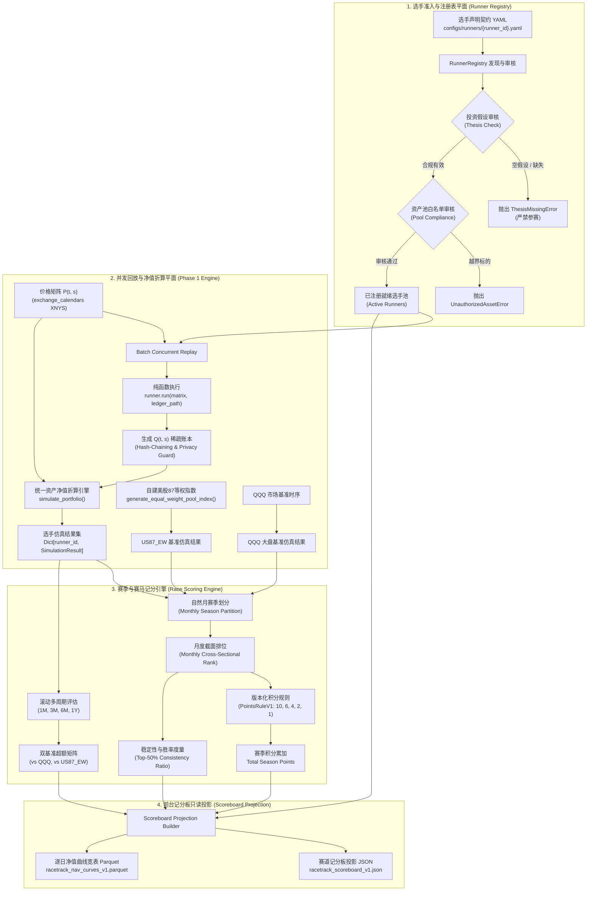
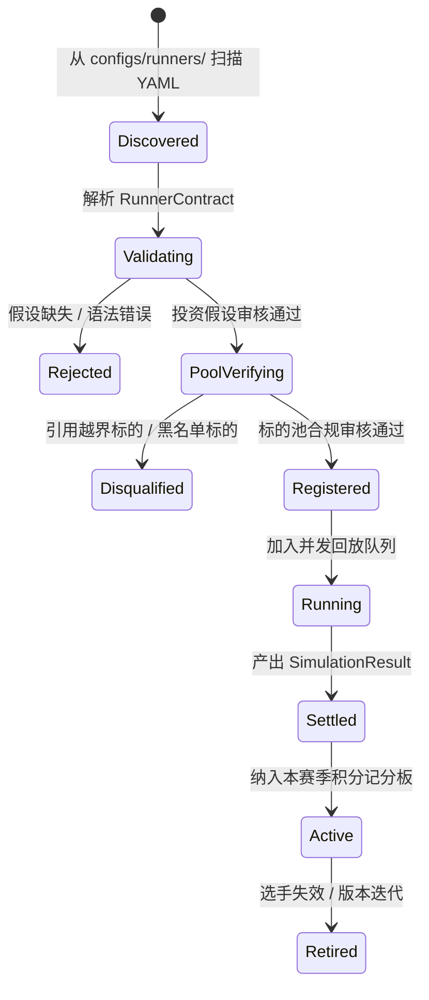

# Racetrack 选手准入与赛道记分系统技术规范 (Phase 2 Spec)
## Racetrack Runner Admission & Race Scoring Technical Specification

- **状态**: **草案 / 实施规范 (Phase 2 Specification)**
- **规划基准**: Track B Phase 2 (#1306) · 关联 RFC [`docs/product/racetrack_vision_2026-10-27.md`](file:///D:/Documents/GitHub/alphaengine/docs/product/racetrack_vision_2026-10-27.md) §2, §3, §5, §11.1, §11.2 第 2 步
- **前置依赖**: Phase 1 Minimal Stack [`docs/architecture/racetrack_minimal_stack_spec.md`](file:///D:/Documents/GitHub/alphaengine/docs/architecture/racetrack_minimal_stack_spec.md)
- **权威层级**: 下位规范，受制于 [`AGENTS.md`](file:///D:/Documents/GitHub/alphaengine/AGENTS.md)、ADR-0003 与 [ADR-0005](file:///D:/Documents/GitHub/alphaengine/docs/architecture/adr-0005-point-in-time-information-state-semantics.md)
- **运行铁律**: `research_only=true` · `trade_ready=false` · 假设前置 (Thesis-Gated) · 赛马非孤立回测 · 杜绝单日暴涨后视偏差 · 绝对隔离个人账户隐私

---

## 1. 架构定位与系统边界 (Context & Architecture Boundaries)

### 1.1 从“净值折算”到“赛马竞技”的范式演进
在 Phase 1 Minimal Stack 中，系统构建了原生行情矩阵 $P(t, s)$、稀疏事件账本 $Q(t, s)$、统一资产净值折算引擎（V & NAV Engine）以及美股 87 月度等权选股池基准指数（US87_EW）。这确立了投研数据事实量与净值折算的物理基础。

Phase 2 的核心使命是依据 PR #1306 §2、§3、§5 与 §11.2，将原本孤立的策略回测脚本升级为**标准化、制度化的赛道竞技系统 (Racetrack Competitive System)**：
1. **策略实体化为 Runner（选手）**：任何参赛模型必须持有严肃的书面投资假设（Thesis），严禁空假设策略参赛；选股逻辑与调仓逻辑结构化解耦；
2. **时间制度化为 Season（赛季）**：确立以自然月为周期的单月赛季（Monthly Season），月初统一起跑，月末收盘统一结算；
3. **评价多维化为多周期滚动窗**：同步评估 1M、3M、6M、1Y 收益率，以及相对于外部大盘（QQQ）和内部股票池（US87_EW）的双重超额收益；
4. **积分制度化为月度排位赛 (Cross-Sectional Rank & Season Points)**：月度按截面净收益率排序分配积分，累加赛季积分，奖励长期稳定在前列的“长跑冠军”，彻底瓦解“单日暴涨即夺冠”的幸存者偏差；
5. **前台表现为只读记分板 (Scoreboard)**：输出结构化投影，以连续净值曲线为中心，辅助以各月排名轨迹、多周期收益矩阵与赛道天气归因。

### 1.2 核心设计铁律 (System Invariants)
1. **假设缺失即阻断 (Thesis-First Gate)**：未提供书面假设、或假设内容为空白/敷衍的策略，系统直接抛出 `ThesisMissingError`，物理上禁止注册和参与回放；
2. **标的池严格封闭 (Closed Pool Invariant)**：选手只能从其声明的 `pool_id`（如 `us_selected_equities_v2`）所包含的候选标的中分配权重，任何分配给池外“黑户”标的的行为立即触发 `UnauthorizedAssetError` 熔断；
3. **单一推导权威 (Single Derivation Authority)**：记分板与赛季积分属于可丢弃、可完全重建的衍生分析制品（Projections），原始事实量只有行情矩阵与选手账本。删除所有记分制品后，重跑流水线能 100% 确定性复现；
4. **绝无调度器与无数据库污染**：纯函数式驱动，注册表只维护轻量内存对象与不可变清单，不引入后台常驻守护进程或外部数据库服务。

### 1.3 整体系统架构全景 (System Architecture Flow)



---

## 2. Runner（选手）契约规范 (Runner Contract Specification)

### 2.1 选手实体数据契约 (`RunnerContract`)
每个参赛选手在系统中被抽象为一个不可变的数据对象（`RunnerContract`），在注册阶段必须完成强类型校验。

```python
@dataclass(frozen=True)
class RunnerContract:
    """不可变选手契约实体，严格定义策略的参赛资格、假设与逻辑。"""

    runner_id: str                      # 选手唯一标识符 (例如 "momentum_cross_section_v1")
    runner_version: str                 # 语义化版本号 (例如 "1.0.0")
    pool_id: str                        # 绑定的股票候选池 (例如 "us_selected_equities_v2")
    benchmark_symbol: str               # 外部对比基准代码 (例如 "QQQ")
    thesis: str                         # 书面投资假设 (强制要求，空值直接拒绝)
    selection_logic: str                # 选股逻辑描述与算法标识
    rebalance_logic: str                # 调仓再平衡逻辑描述
    track_condition_associations: dict[str, str] # 赛道天气关联 (如 {"VIX": "headwind", "SPY_MA200": "tailwind"})
    author: str                         # 策略构建人 / 模型代号
    created_at_utc: str                 # 注册创建时间戳 (ISO 8601 UTC)
```

### 2.2 投资假设强制门禁 (Mandatory Thesis Gate)
依据 PR #1306 §2 铁律：“*A runner without a thesis does not enter the race, however good its curve looks.*”（没有书面投资假设的策略，哪怕其历史回测曲线再完美，也绝不允许入场参赛）。

#### 1. 假设契约内容要求
投资假设 `thesis` 必须明确回答以下 3 个维度的核心投研问题：
- **Why it was built (构建原因与经济学动因)**：该策略试图捕捉市场的何种非理性、流动性溢价或基本面驱动力？
- **What market phenomenon it bets on (押注的具体市场现象)**：是截面多因子动量、估值均值回归、波动率低估，还是事件驱动？
- **When it should fail (预期失效与逆风场景)**：策略在何种宏观与市场环境下会回撤或失效？（杜绝虚假的“全天候稳赚”假设）。

#### 2. 校验与阻断机制
在选手加载与注册入口，系统必须执行严格的静态文本门禁：
```python
class ThesisMissingError(ValueError):
    """Raised when a runner contract lacks a valid, substantive investment thesis."""

def validate_runner_thesis(thesis: str | None) -> None:
    if thesis is None or not thesis.strip():
        raise ThesisMissingError(
            "Runner rejected: thesis cannot be empty. Every runner must have a written "
            "investment thesis explaining why it was built, what it bets on, and when it fails."
        )
    clean_thesis = thesis.strip()
    if len(clean_thesis) < 30:
        raise ThesisMissingError(
            f"Runner rejected: thesis is too terse ({len(clean_thesis)} chars < 30 chars threshold). "
            "Must provide a substantive written investment rationale."
        )
```

### 2.3 选股逻辑与调仓逻辑解耦 (`selection_logic` & `rebalance_logic`)
在量化系统中，选股（Cross-Sectional Stock Selection）与择时/组合权重优化（Portfolio Allocation & Rebalance）是两个正交的维度：
1. **`selection_logic`（选股逻辑）**：
   - 规定在每一个再平衡周期，如何从候选池 $S$（87只股票）中筛选出目标持仓子集 $S_{held} \subset S$；
   - 必须指明所依赖的因子特征（如 `momentum_20d`）、排序方向（升序/降序）、截面分位数或硬性选股数量（如 Top 10% 或固定 5 只）；
2. **`rebalance_logic`（调仓逻辑）**：
   - 规定何时触发调仓，以及如何将资金分配到目标股票上；
   - 包含再平衡触发频率（如每个自然月初、固定每 20 交易日、或阈值偏离触发）；
   - 包含权重赋权算法（如严格等权 $w_i = 1/k$、市值加权、或反向波动率加权）；
   - 包含现金持有约束与止损风控规则。

### 2.4 赛道天气环境关联契约 (`track_condition_associations`)
依据 PR #1306 §2 与 §11.1 决议：赛道天气（Track Condition）是外生环境对象，不参赛也不得分，但用于在赛后解释选手胜负的客观归因。
选手契约必须显式声明其与常见赛道天气的关联性字典 `track_condition_associations`：
- **关联类型**：
  - `"headwind"` (逆风/负相关)：该环境指标走高时，该策略面临挑战（例如高波动率市场对低波策略是逆风）；
  - `"tailwind"` (顺风/正相关)：该环境指标走高时，该策略如鱼得水；
  - `"neutral"` (中性/弱相关)：该指标对该策略影响不显著；
- **标准天气指标声明**：
  - `market_regime_volatility` (如 VIX 水平)：`"headwind"` / `"tailwind"`；
  - `market_trend` (如 SPY/QQQ 处于 200 日均线上方)：`"tailwind"` / `"headwind"`；
  - `cross_sectional_dispersion` (美股 87 选股池收益离散度)：`"tailwind"` / `"neutral"`。

### 2.5 纯函数式执行接口契约 (`run`)
选手在代码实现层面，必须实现符合以下纯函数式签名的接口：

```python
from abc import ABC, abstractmethod
from pathlib import Path
from src.racetrack.contracts import PriceMatrix, SimulationResult

class BaseRunner(ABC):
    """Abstract base class for all competitive racetrack runners."""

    def __init__(self, contract: RunnerContract) -> None:
        self.contract = contract
        # 强制在实例化时验证投资假设
        validate_runner_thesis(contract.thesis)

    @abstractmethod
    def generate_rebalance_events(
        self,
        matrix: PriceMatrix
    ) -> list[RebalanceEvent]:
        """纯函数式：输入价格矩阵，输出符合 Phase 1 规范的稀疏调仓事件列表。

        要求：
        1. 严格使用 exchange_calendars 判定交易日；
        2. 目标标的必须严格属于 matrix.candidate_symbols；
        3. 权重和 <= 1.0，严禁负权重；
        4. 调仓事件必须按时间单调递增并形成 SHA-256 哈希链。
        """
        pass

    def run(
        self,
        matrix: PriceMatrix,
        ledger_path: Path | None = None,
        config: EngineConfig = EngineConfig(),
    ) -> SimulationResult:
        """执行全流程回放与净值仿真，落盘事件账本并返回标准 SimulationResult。"""
        events = self.generate_rebalance_events(matrix)

        # 1. 若指定账本路径，序列化为不可变 JSONL 账本
        if ledger_path is not None:
            ledger = EventLedger(ledger_path)
            for ev in events:
                ledger.append_event(ev)
            ledger.save()

        # 2. 调用 Phase 1 统一净值折算引擎完成逐日漂移、换手摩擦与指标计算
        result = simulate_portfolio(matrix=matrix, ledger_events=events, config=config)
        return result
```

---

## 3. RunnerRegistry 注册表规范 (Runner Registry Specification)

### 3.1 注册表职责与生命周期
`RunnerRegistry` 是管理赛道选手准入、合规检查与回放调度的核心单例实体（无外置状态，以配置文件与文件系统为物理媒介）。



### 3.2 标的池合规性与资产白名单静态审核 (Pool Compliance & Asset Whitelist Gate)
在注册任何策略前，`RunnerRegistry` 必须执行严格的资产池合规断言：
1. **选股池绑定检查**：策略声明的 `pool_id` 必须存在于官方池注册表（如 `configs/research_universes/us_selected_equities_v2.yaml`）；
2. **标的白名单静态检验 (Static Whitelist Assertion)**：
   - 提取策略代码或配置中引用的所有固定标的代码；
   - 断言集合属于合法子集：$S_{runner} \subseteq S_{candidates}$；
   - 杜绝偷放标的：基准标的（如 `QQQ`）属于 reference 角色，严禁出现在策略的目标持仓字典中；池外未注册代码一律拦截并抛出 `UnauthorizedAssetError`。

### 3.3 批量并发回放与防作弊机制 (Batch Concurrent Replay & Anti-Cheat Guard)
1. **多选手无依赖并发 (Embarrassingly Parallel Replay)**：
   - 各选手的 `run(matrix)` 过程完全正交、互不干扰；
   - 注册表通过 `concurrent.futures.ProcessPoolExecutor` 并发驱动所有已注册选手的回放计算，最大化榨干多核 CPU 算力；
2. **防作弊时间前瞻审查 (Anti-Lookahead Audit)**：
   - 校验事件流的 `effective_session` 与其依赖价格的时间戳；
   - 严格禁止在 $t$ 日决策时使用 $t$ 日收盘之后产生的数据或未来信息（遵守 ADR-0005 PIT 铁律）；
3. **确定性审计 (Deterministic Execution)**：
   - 相同版本代码在相同价格矩阵上回放，两次运行生成的账本末梢哈希 `ledger_tip_hash` 必须 100% 相同。

---

## 4. Season 赛季与时间窗口规范 (Season & Time Window Specification)

### 4.1 单月赛季默认规则 (Monthly Season Cadence)
依据 PR #1306 §11.1 裁定，本规范确立**单月赛季（Monthly Season）**作为标准运行周期：
1. **赛季周期**：对应公历自然月（Calendar Month，例如 `2024-01`, `2024-02`, ...）；
2. **赛季起跑点 (Season Start)**：
   - 当月在官方交易所日历（`XNYS`）中的**首个交易日**（$t_{m, start}$）；
   - 在该交易日开盘前，所有参赛选手的资产价值重置归一为基准点 $1.00000000$（逻辑视图重新归一，底层连续净值不受影响）；
3. **赛季结算点 (Season Settlement)**：
   - 当月在交易所日历中的**最后一个交易日**（$t_{m, end}$）收盘后；
   - 系统提取当月所有交易日收益率序列，计算各选手的**当月净收益率 (Monthly Net Return)**：
     $$R_{runner, m} = \frac{\text{NAV}_{runner}(t_{m, end})}{\text{NAV}_{runner}(t_{m-1, end})} - 1 = \prod_{t=t_{m, start}}^{t_{m, end}} (1 + r_{net, t}) - 1$$
   - 触发截面排位与积分授予。

### 4.2 交易日历对齐机制 (`exchange_calendars`)
系统禁止任何硬编码的自然日切分（例如以每月的 1 号和 31 号粗暴切分）。
- **交易所日历实例**：美股赛道强制绑定 `exchange_calendars.get_calendar("XNYS")`；
- **月末判定函数**：
  交易日 $t$ 是当月最后结算日的充要条件为：
  $$t \in T \quad \land \quad \Big( t == T[-1] \quad \lor \quad \text{month}(T[index(t) + 1]) \ne \text{month}(t) \Big)$$
- **节假日与半日市合规**：如遇感恩节翌日半日市（Early Close）或耶稣受难日（Good Friday）提前休市，完全遵从官方交易会话，不遗漏、不补造假交易日。

### 4.3 滚动多周期评估窗规范 (Rolling Multi-Period Windows)
为打破传统“以单一回测区间论英雄”的片面性，在任意结算日 $t_{settle}$，系统必须同时计算以下 4 个标准滚动时间窗口的绩效表现：

| 评估窗口 | 周期定义 | 典型美股交易日数 $N_{days}$ | 核心评估目的 |
| :--- | :--- | :--- | :--- |
| **1M (最近 1 个月)** | 最近 1 个自然月 | 约 20 ~ 22 交易日 | 敏锐捕捉策略最新适应状态与短期突发风险 |
| **3M (最近 3 个月)** | 最近 3 个自然月（季度） | 约 63 交易日 | 评估季度动量延续性与中短期风格轮动 |
| **6M (最近半年)** | 最近 6 个自然月（半年） | 约 126 交易日 | 考察策略跨越不同宏观与波动率环境的韧性 |
| **1Y (最近 1 年)** | 最近 12 个自然月（年度） | 约 252 交易日 | 评估完整年度周期的长期复利与深层 Alpha 质量 |

### 4.4 双基准超额收益数学模型 (Excess Returns vs Dual Benchmarks)
在每个评估窗口 $W \in \{1M, 3M, 6M, 1Y\}$ 内，系统必须独立计算策略相对于两个基准的超额收益：

#### 1. 相对外部大盘基准（QQQ）超额收益
衡量策略是否战胜了纳斯达克 100 科技大盘的 Beta：
$$R_{excess\_qqq}^{(W)} = R_{runner}^{(W)} - R_{QQQ}^{(W)}$$

#### 2. 相对内部股票池等权指数（US87_EW）超额收益
衡量策略在给定 87 只候选股票范围内，其主动选股与调仓择时逻辑是否创造了纯粹的正向 Alpha：
$$R_{excess\_pool}^{(W)} = R_{runner}^{(W)} - R_{US87\_EW}^{(W)}$$
- 若 $R_{excess\_pool}^{(W)} > 0$，证明策略选股逻辑优于盲目均摊，产生正 Alpha；
- 若 $R_{excess\_pool}^{(W)} \le 0$，即使 $R_{runner} > 0$，也表明策略收益全靠股票池整体 Beta 抬升，自身选股甚至是负贡献。

---

## 5. 赛马记分与月度排名算法 (Race Scoring & Ranking Algorithm)

### 5.1 月度截面排位数学模型 (Monthly Cross-Sectional Ranking)
在自然月 $m$ 结算时：
1. 收集所有处于活跃运行状态的选手集合 $\mathcal{R}_m = \{runner_1, runner_2, \dots, runner_K\}$；
2. 提取每个选手在当月的净收益率 $R_{i, m}$；
3. 执行**降序截面排位 (Descending Cross-Sectional Sort)**：
   $$\text{Rank}_{i, m} = \text{rank}\Big( -R_{i, m} \Big), \quad \text{Rank} \in \{1, 2, \dots, K\}$$
   （收益率最高者为第 1 名，次高者为第 2 名，以此类推。若收益率并列，采用并列同名次处理）。

### 5.2 版本化赛季积分映射规则 (`PointsRuleV1`)
为杜绝回溯性篡改积分计算口径，积分映射算法必须显式版本化，并在赛季开始前完全冻结。

#### 1. PointsRuleV1 积分规则矩阵
依据 F1 赛车与国际赛马积分理念，Phase 2 默认确立 **`PointsRuleV1`**：
- **前排定额积分制**：
  $$\text{Points}(Rank) = \begin{cases}
  10 & \text{if } Rank = 1 \\
  6 & \text{if } Rank = 2 \\
  4 & \text{if } Rank = 3 \\
  2 & \text{if } Rank = 4 \\
  1 & \text{if } Rank = 5 \\
  0 & \text{if } Rank > 5
  \end{cases}$$
- **前 20% 相对积分制（备选/大规模选手池拓展）**：
  当活跃选手总数 $K \ge 20$ 时，可平滑切换为百分比分位点得分，但在当前 4~10 个重点模型阶段，严格锁定前排定额 `PointsRuleV1`。

#### 2. 赛季总积分累加 (Season Points Accumulation)
策略在赛季内累计的总分为各月份积分的代数和：
$$\text{TotalPoints}_{runner} = \sum_{m=1}^{M_{season}} \text{Points}(\text{Rank}_{runner, m})$$

### 5.3 稳定性度量与长跑冠军指标 (Persistence Indicator)
为科学区分“昙花一现（Flash in the Pan）”与“长跑冠军（Marathon Winner）”，系统定义三个维度的稳定性度量：

#### 1. 前 50% 胜率月份占比 (Top-50% Consistency Ratio)
定义为策略在所有参跑月份中，排位处于上半区（前 50%）的月份比例：
$$\text{Persistence} = \frac{\sum_{m=1}^{M} \mathbb{I}\left( \text{Rank}_{i, m} \le \lceil K_m / 2 \rceil \right)}{M}$$
其中 $\mathbb{I}(\cdot)$ 为指示函数，$M$ 为总参赛月数。
- $\text{Persistence} \ge 70\%$：判定为高持续性、高可靠性的**长跑型选手**；
- $\text{Persistence} \le 30\%$：即便年化收益率很高，也判定为**高脆弱性/突发型选手**。

#### 2. 最长连续得分月数 (Max Consecutive Scoring Months)
统计策略连续获得非零积分（即位列当月前 5 名）的最长连续月数，表征策略在特定市场趋势下的持续进攻能力。

#### 3. 月度排位波动率 (Rank Volatility)
计算策略历月排位的标准差 $\sigma(\text{Rank}_{i})$。排位波动率越小，说明策略排名越稳定，抗周期能力越强。

### 5.4 防后视偏差机制：为什么单日暴涨无法夺冠
传统的总资产回测模型存在致命缺陷：**单日极端行情的过度主导**。
- 假设策略 A 在全年的 251 个交易日表现平平，仅在某 1 天因押中单只垃圾股暴涨 300%，其全年的 CAGR、夏普比率和累积净值会极为亮眼；
- 但在实际投资中，这种策略是典型的黑天鹅与过拟合产物，无法复现。

**在 Racetrack 赛道机制下的防作弊证明**：
1. 在 Racetrack 体系下，策略 A 的单日暴涨只能帮它赢得那 1 个月的第 1 名（获得 10 分）；
2. 在其余 11 个月里，策略 A 均位于末流，得 0 分；全年赛季总积分仅为 $10 + 0 \times 11 = 10 \text{ 分}$；
3. 相比之下，策略 B 没有任何单日暴跌或暴涨，但每月选股均衡，稳扎稳打，每个月均排在第 2 或第 3 名（每月获得 6 分或 4 分）；
4. 策略 B 的全年总积分为 $5 \times 12 \approx 60 \text{ 分}$，以压倒性优势荣获赛季总冠军；
5. **结论**：本机制无需人为制定主观的“稳定性惩罚公式”，仅凭月度截面排位与累加积分的数学结构，便天然在机制层面彻底剔除了单日暴涨后视偏差，精准筛选出经得起时间考验的高适应性策略。

---

## 6. Scoreboard 前台记分板数据投影契约 (Scoreboard Projection Contract)

### 6.1 前台只读记分板定位与消费原则
依据 PR #1306 §5，前端页面是一个严肃的**赛道记分板（Scoreboard）**，而非复杂的控制面板：
- **只读架构**：前台严禁发起任何计算、回放或数据拉取；前台只消费后台离线预计算好的静态 JSON 投影；
- **单一中心视图**：以统一归一化为 1.0 的净值曲线为视觉核心，QQQ 与 US87_EW 作为对照基准线；
- **下层挂接记分板与天气解说**：支持点击任意选手曲线，高亮展示其月度排位历程、投资假设和天气适应度。

### 6.2 记分板投影 Schema 契约 (`racetrack_scoreboard_v1.json`)

```json
{
  "$schema": "https://json-schema.org/draft/2020-12/schema",
  "title": "RacetrackScoreboardProjection",
  "type": "object",
  "required": [
    "schema_version",
    "market",
    "pool_id",
    "updated_at_utc",
    "active_season",
    "total_runners",
    "scoreboard_entries",
    "benchmarks"
  ],
  "properties": {
    "schema_version": { "type": "string", "enum": ["1.0"] },
    "market": { "type": "string", "enum": ["us"] },
    "pool_id": { "type": "string", "enum": ["us_selected_equities_v2"] },
    "updated_at_utc": { "type": "string", "format": "date-time" },
    "active_season": {
      "type": "object",
      "required": ["season_id", "season_type", "start_session", "end_session", "points_rule"],
      "properties": {
        "season_id": { "type": "string", "example": "season_2024_full" },
        "season_type": { "type": "string", "enum": ["monthly_series"] },
        "start_session": { "type": "string", "format": "date" },
        "end_session": { "type": "string", "format": "date" },
        "points_rule": { "type": "string", "enum": ["PointsRuleV1"] }
      }
    },
    "scoreboard_entries": {
      "type": "array",
      "items": {
        "type": "object",
        "required": [
          "rank",
          "runner_id",
          "runner_version",
          "thesis_summary",
          "season_points",
          "persistence_ratio",
          "returns_matrix",
          "excess_matrix",
          "risk_metrics",
          "monthly_ranks",
          "weather_profile"
        ],
        "properties": {
          "rank": { "type": "integer", "minimum": 1 },
          "runner_id": { "type": "string" },
          "runner_version": { "type": "string" },
          "thesis_summary": { "type": "string" },
          "season_points": { "type": "integer", "minimum": 0 },
          "persistence_ratio": { "type": "number", "minimum": 0.0, "maximum": 1.0 },
          "returns_matrix": {
            "type": "object",
            "required": ["ret_1m", "ret_3m", "ret_6m", "ret_1y", "ret_cumulative"],
            "properties": {
              "ret_1m": { "type": ["number", "null"] },
              "ret_3m": { "type": ["number", "null"] },
              "ret_6m": { "type": ["number", "null"] },
              "ret_1y": { "type": ["number", "null"] },
              "ret_cumulative": { "type": "number" }
            }
          },
          "excess_matrix": {
            "type": "object",
            "required": ["vs_qqq_1y", "vs_pool_1y", "vs_qqq_cumulative", "vs_pool_cumulative"],
            "properties": {
              "vs_qqq_1y": { "type": ["number", "null"] },
              "vs_pool_1y": { "type": ["number", "null"] },
              "vs_qqq_cumulative": { "type": "number" },
              "vs_pool_cumulative": { "type": "number" }
            }
          },
          "risk_metrics": {
            "type": "object",
            "required": ["max_drawdown", "annualized_sharpe", "annualized_volatility", "cumulative_turnover"],
            "properties": {
              "max_drawdown": { "type": "number" },
              "annualized_sharpe": { "type": "number" },
              "annualized_volatility": { "type": "number" },
              "cumulative_turnover": { "type": "number" }
            }
          },
          "monthly_ranks": {
            "type": "array",
            "items": {
              "type": "object",
              "required": ["month", "rank", "monthly_return", "points_awarded"],
              "properties": {
                "month": { "type": "string", "pattern": "^[0-9]{4}-[0-9]{2}$" },
                "rank": { "type": "integer", "minimum": 1 },
                "monthly_return": { "type": "number" },
                "points_awarded": { "type": "integer", "minimum": 0 }
              }
            }
          },
          "weather_profile": {
            "type": "object",
            "additionalProperties": { "type": "string", "enum": ["headwind", "tailwind", "neutral"] }
          }
        }
      }
    },
    "benchmarks": {
      "type": "object",
      "required": ["qqq", "us87_ew"],
      "properties": {
        "qqq": { "type": "object" },
        "us87_ew": { "type": "object" }
      }
    }
  }
}
```

---

## 7. 系统实现架构与工程流水线 (Implementation Architecture)

### 7.1 核心 Python 模块拓扑
在 Phase 2 中，`src/racetrack/` 将新增两个核心子模块，与 Phase 1 模块紧密协同：

```text
src/racetrack/
├── __init__.py
├── contracts.py              # Phase 1 基础契约 + Phase 2 RunnerContract / ScoreboardContract
├── matrix.py                 # Phase 1 价格矩阵构建器
├── ledger.py                 # Phase 1 哈希链持仓账本
├── engine.py                 # Phase 1 统一净值折算引擎
├── pool_index.py             # Phase 1 美股 87 等权基准指数
├── runner.py                 # Phase 2: BaseRunner, RunnerRegistry, 假设验证器 (新增)
└── scoring.py                # Phase 2: 月度排位、PointsRuleV1、记分板投影生成器 (新增)
```

### 7.2 核心函数签名规范 (Core Signatures)

```python
# src/racetrack/scoring.py 核心概念签名

@dataclass(frozen=True)
class MonthlyRankResult:
    """单月截面排名与得分明细。"""
    month: str                         # "YYYY-MM"
    runner_id: str
    rank: int                          # 1, 2, ...
    monthly_return: float
    points_awarded: int                # 10, 6, 4, 2, 1, 0


def partition_into_monthly_seasons(
    sessions: Sequence[str]
) -> list[tuple[str, str, str]]:
    """依据 exchange_calendars 将交易日序列划分为自然月赛季元组列表。

    Returns:
        [(month_str, start_session, end_session), ...]
    """
    ...


def calculate_monthly_cross_sectional_ranks(
    simulation_results: Mapping[str, SimulationResult],
    sessions: Sequence[str],
    points_rule_name: str = "PointsRuleV1",
) -> list[MonthlyRankResult]:
    """纯函数式：对所有选手在各自然月内的净收益率进行截面降序排序，并赋予赛季积分。"""
    ...


def compute_rolling_windows_returns(
    simulation_result: SimulationResult,
    eval_session: str,
) -> dict[str, float | None]:
    """计算截至 eval_session 最近 1M, 3M, 6M, 1Y 的复合收益率。"""
    ...


def build_racetrack_scoreboard(
    runners: Sequence[RunnerContract],
    simulation_results: Mapping[str, SimulationResult],
    pool_benchmark_result: SimulationResult,
    market_benchmark_result: SimulationResult,
    matrix: PriceMatrix,
    season_id: str = "season_default",
) -> dict[str, Any]:
    """汇总所有计算结果，生成符合 Schema 的只读 Scoreboard 投影字典。"""
    ...
```

---

## 8. 负面测试与边界验证矩阵 (Verification & Testing Matrix)

为确保 Phase 2 赛道机制的代码可靠性与学术严密性，测试套件必须全面覆盖以下 10 项严密测试：

| 测试用例 ID | 测试类别 | 测试输入条件 / 场景 | 预期断言与阻断行为 |
| :--- | :--- | :--- | :--- |
| **TEST-RT-P2-01** | 空假设严格拦截 | 注册空字符串、纯空格或 `None` 的投资假设 | 立即抛出 `ThesisMissingError`，拒绝实例化与注册。 |
| **TEST-RT-P2-02** | 敷衍假设短文本拦截 | 注册少于 30 个有效字符的简短敷衍假设（如 `"momentum strategy"`） | 立即抛出 `ThesisMissingError`，要求详实投资逻辑。 |
| **TEST-RT-P2-03** | 跨池标的越界拦截 | 选手持仓中分配了非美股 87 池的非法标的（如池外中概股） | 注册表静态扫描抛出 `UnauthorizedAssetError`，阻断准入。 |
| **TEST-RT-P2-04** | 基准标的串味拦截 | 选手试图在持仓中买入 `QQQ`（基准参考标的） | 抛出 `UnauthorizedAssetError`，确保候选池与基准角色隔离。 |
| **TEST-RT-P2-05** | 自然月月末交易日对齐 | 遇到 12 月 31 日休市（提前至 30 日收盘结算） | 引擎精准识别当月最后真实交易日结算，无日期偏移。 |
| **TEST-RT-P2-06** | 多周期收益位级自洽 | 对比 1M 滚动收益率与当月净收益率 | 两者数值位级一致（`assert abs(r_1m - r_month) < 1e-12`）。 |
| **TEST-RT-P2-07** | 积分规则确定性 | 模拟 5 个策略月度收益率严格从高到低排列 | 验证积分精准对应 `10, 6, 4, 2, 1`，其余策略得 `0`。 |
| **TEST-RT-P2-08** | 单日暴涨惩戒效应验证 | 对比“单日暴涨300%但其余月份惨淡”策略与“月月前三名”稳健策略 | 验证稳健策略的赛季总积分以绝对优势胜出（积分防作弊验证）。 |
| **TEST-RT-P2-09** | 持续性胜率计算验证 | 策略在 12 个月中 9 个月位居前 50% | 验证 `persistence_ratio == 0.75`，准确标记为长跑型策略。 |
| **TEST-RT-P2-10** | 记分板投影 Schema 校验 | 生成的 `racetrack_scoreboard_v1.json` 结构 | 通过严格 JSON Schema 验证，零未知字段，零缺失字段。 |

---

## 9. 交付标准与推进路径 (Definition of Done)

1. **架构规范归档**：本技术规范正式入库于 `docs/architecture/racetrack_runner_scoring_spec.md`，作为 Phase 2 赛马机制的唯一权威实现依据；
2. **PR #1306 链接更新**：在 `docs/product/racetrack_vision_2026-10-27.md` 的末尾追加第 13 节，正式建立对本 Phase 2 实施规范的引用；
3. **实现准入准备**：代码实现阶段将严格依据本规范的 `RunnerContract`, `RunnerRegistry`, `PointsRuleV1` 与记分板投影契约展开，维持纯文件、纯函数式与单一推导权威架构。
