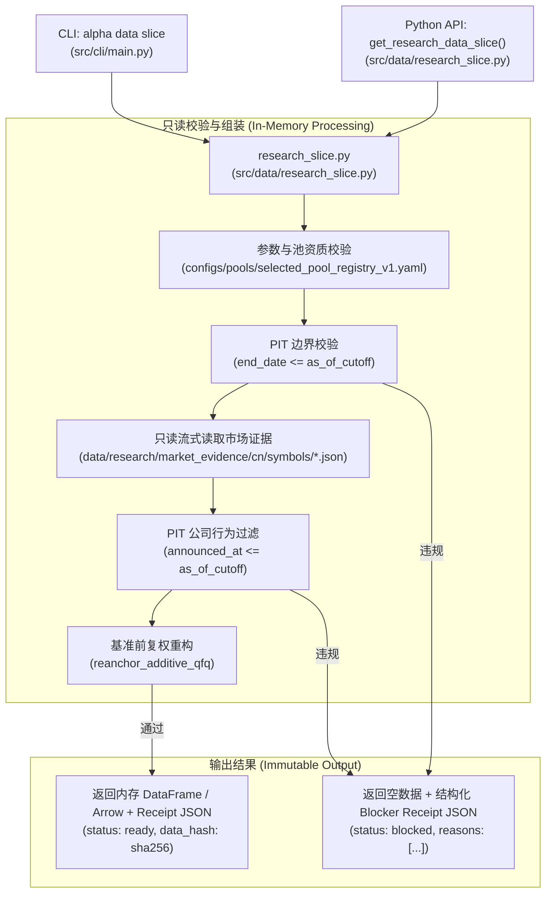

# RI-03A: 可复用投研数据微切片协议与冻结参考样本规范 (Reusable Research Data Slice Specification)

> **版本**：1.0.0 · **规划基准**：Track B Phase B2 (#1296)  
> **权威约束**：[`AGENTS.md`](file:///D:/Documents/GitHub/alphaengine/AGENTS.md) · [ADR-0003](file:///D:/Documents/GitHub/alphaengine/docs/architecture/repository_data_convergence.md) · [ADR-0005](file:///D:/Documents/GitHub/alphaengine/docs/architecture/adr-0005-point-in-time-information-state-semantics.md) · [`investment_research_infrastructure_charter_2026-10-26.md`](file:///D:/Documents/GitHub/alphaengine/docs/product/investment_research_infrastructure_charter_2026-10-26.md)  
> **运行铁律**：`research_only=true` · `trade_ready=false` · 绝不添加重复数据库、第二个编排器或前端独立研究工作台。

---

## 1. 现状审查与唯一真实缺口 (Audit of Existing Interfaces vs. The Single Real Gap)

### 1.1 现有数据能力与接口审计

在 Alpha Engine 现行代码库中，已存在多组具备治理资质的数据工具和存储：

| 现有组件 | 物理路径 | 现有能力 | 局限性与研究者痛点 |
| :--- | :--- | :--- | :--- |
| **`alpha data` CLI** | [`src/cli/main.py`](file:///D:/Documents/GitHub/alphaengine/src/cli/main.py#L40-L68) | 提供 `list`、`prepare`、`status`，支持按 Recipe（如 `cn130-prices`、`us87-prices`、`qqq-rotation`）拉取与校验全量数据集。 | **颗粒度过粗**：只能构建/检查整个股票池（87/130 标的），无法按研究员指定的任意标的子集、自定义时间区间或特征字段提取微切片。 |
| **Model Data Profile 门禁** | [`scripts/data/check_model_data_profile.py`](file:///D:/Documents/GitHub/alphaengine/scripts/data/check_model_data_profile.py)<br>[`src/data/model_data_profile.py`](file:///D:/Documents/GitHub/alphaengine/src/data/model_data_profile.py) | 校验整个训练包的 Ready/Partial 状态及哈希一致性。 | 属于二元门禁（Ready vs Blocked），不提供数据读取或特征提取能力。 |
| **市场证据存储** | `data/research/market_evidence/cn/` | 保存经校验的 130 标的日线 OHLCV JSON 数据及 `catalog.json` 索引，包含逐标的 `sha256`。 | 数据散落于单个 `symbols/{symbol}.json` 文件中，研究者需自行编写 JSON 解析与合并脚本。 |
| **公司行为与复权引擎** | [`src/data/corporate_actions/event_store.py`](file:///D:/Documents/GitHub/alphaengine/src/data/corporate_actions/event_store.py)<br>[`src/data/corporate_actions/adjustment.py`](file:///D:/Documents/GitHub/alphaengine/src/data/corporate_actions/adjustment.py) | 严格实现点时点 (PIT) 公司行为校验、前复权基准重锚定（`reanchor_additive_qfq`），包含公告日 `announced_at <= cutoff` 拦截。 | 缺乏统一调用的参数化 Reader，多由正式模型回测脚本私有嵌入调用，普通研究实验难以复用。 |
| **统一数据包清单** | `data/research/model_data_bundle_v1/data-components.json` | 跟踪价格、基本面、公司行为和 Alpha158 的组件级覆盖度、截止日和 Manifest 哈希。 | 仅作为元数据清册存在，未暴露切片读取接口。 |

### 1.2 唯一真实缺口 (The Single Real Gap)

当前单一研究员在进行新假设探索、因子构造或事件驱动实验时，面临的**唯一真实缺口**是：

> **缺少一个参数化的、轻量级的投研数据切片协议与读取器 (Parameterized Research Data Slice Reader)**：  
> 研究员无法通过一行命令或一次标准函数调用，声明性地输入：
> `“给我市场 M、股票池 P、标的列表 [S1, S2...]，在区间 [D_start, D_end] 内、以时点 T_cutoff 为决策截止日的数据切片，应用复权模式 A，并返回提取结果及其不可变证据收据 (Receipt)。”`

由于缺少该协议，导致研究员不得不复制 ad-hoc 脚本解析原始 JSON/CSV，产生以下严重隐患：
1. **PIT 泄露风险**：脚本容易忽略 `announced_at > T_cutoff` 的未来除权除息公告，直接使用当期已复权数据。
2. **重复存储膨胀**：研究者将数据拷贝到个人 SQLite/DuckDB 或临时目录，造成多份不一致的数据影子。
3. **收据缺失**：实验结果无法精确溯源到具体的数据切片哈希与原始 Manifest 版本，无法被审计或独立重放。

### 1.3 杜绝重复冗余架构原则 (No-Duplication Architecture)

本规范严格遵守 `AGENTS.md` 约束：
- **不新增数据库**：严禁引入 DuckDB、ClickHouse 或第二套 SQLite 状态库。
- **不新增调度器**：不建立常驻后台轮询任务或数据同步进程。
- **不复制原始大数据**：切片读取器通过内存视图、生成器或轻量临时投影直接读取现存的 `data/research/` 权威文件。
- **数据收据 (Receipt) 仅保留引用与摘要**：收据中记录源文件 SHA256、请求参数摘要、行数统计、切片数据 SHA256，而不是把全量原始数据冗余打包进收据。

---

## 2. 最小投研数据切片协议 (Minimal Research Data Slice Protocol)

### 2.1 请求规范 (DataSliceRequest Schema)

```json
{
  "$schema": "https://json-schema.org/draft/2020-12/schema",
  "title": "DataSliceRequest",
  "type": "object",
  "required": [
    "market",
    "pool_id",
    "symbols",
    "start_date",
    "end_date",
    "as_of_cutoff",
    "price_mode",
    "required_fields"
  ],
  "properties": {
    "market": {
      "type": "string",
      "enum": ["cn", "us"],
      "description": "市场标识，严格隔离，禁止跨市场混用"
    },
    "pool_id": {
      "type": "string",
      "description": "所属被治理选股池 ID，例如 cn_selected_equities_v3"
    },
    "symbols": {
      "type": "array",
      "items": { "type": "string" },
      "minItems": 1,
      "description": "请求的标的代码列表，例如 ['000001', '000338']"
    },
    "start_date": {
      "type": "string",
      "format": "date",
      "description": "研究区间起始日期 YYYY-MM-DD"
    },
    "end_date": {
      "type": "string",
      "format": "date",
      "description": "研究区间结束日期 YYYY-MM-DD (必须满足 end_date <= as_of_cutoff)"
    },
    "as_of_cutoff": {
      "type": "string",
      "format": "date",
      "description": "严格的点时点决策截止日 T_cutoff，严禁使用此日期后已知的信息"
    },
    "price_mode": {
      "type": "string",
      "enum": ["raw", "anchored_adjusted"],
      "description": "价格复权模式：raw (原始撮合价格，用于执行和归因) 或 anchored_adjusted (以固定锚点重构的前复权价格，用于特征计算)"
    },
    "required_fields": {
      "type": "array",
      "items": {
        "type": "string",
        "enum": ["open", "high", "low", "close", "volume", "amount"]
      },
      "minItems": 1,
      "description": "请求的基础行情字段"
    },
    "include_corporate_actions": {
      "type": "boolean",
      "default": false,
      "description": "是否在切片元数据中附加 PIT 生效的公司行为记录"
    }
  },
  "additionalProperties": false
}
```

### 2.2 收据规范 (DataSliceReceipt Schema)

```json
{
  "$schema": "https://json-schema.org/draft/2020-12/schema",
  "title": "DataSliceReceipt",
  "type": "object",
  "required": [
    "schema_version",
    "slice_id",
    "request_hash",
    "status",
    "market",
    "pool_id",
    "as_of_cutoff",
    "rights_label",
    "research_only",
    "trade_ready",
    "generated_at_utc"
  ],
  "properties": {
    "schema_version": { "type": "string", "const": "research_data_slice_v1" },
    "slice_id": { "type": "string", "description": "切片唯一指纹：slice_{market}_{hash[:12]}" },
    "request_hash": { "type": "string", "description": "规范化请求 JSON 的 SHA256 哈希" },
    "status": {
      "type": "string",
      "enum": ["ready", "blocked"],
      "description": "切片生成状态：ready 表示完全可用；blocked 表示触发 PIT 或数据质量阻断"
    },
    "blocked_reasons": {
      "type": "array",
      "items": {
        "type": "object",
        "required": ["code", "symbol", "message"],
        "properties": {
          "code": {
            "type": "string",
            "enum": [
              "PIT_VIOLATION_FUTURE_EVENT_ANNOUNCEMENT",
              "PIT_VIOLATION_LOOKAHEAD_CUTOFF",
              "SYMBOL_NOT_IN_GOVERNED_POOL",
              "SYMBOL_NOT_YET_LISTED",
              "DATA_MISSING_FOR_DATE_RANGE",
              "SOURCE_HASH_MISMATCH"
            ]
          },
          "symbol": { "type": "string" },
          "message": { "type": "string" }
        }
      }
    },
    "data_hash": {
      "type": ["string", "null"],
      "description": "切片数据表格（按 symbol, date 严格排序）的 SHA256；若 blocked 则为 null"
    },
    "total_rows": { "type": "integer", "minimum": 0 },
    "symbol_row_counts": {
      "type": "object",
      "additionalProperties": { "type": "integer" }
    },
    "source_manifest_hashes": {
      "type": "object",
      "description": "所依赖的基础数据组件 Manifest 哈希",
      "additionalProperties": { "type": "string" }
    },
    "market": { "type": "string" },
    "pool_id": { "type": "string" },
    "as_of_cutoff": { "type": "string", "format": "date" },
    "rights_label": {
      "type": "string",
      "const": "academic_and_internal_research_only"
    },
    "research_only": { "type": "boolean", "const": true },
    "trade_ready": { "type": "boolean", "const": false },
    "generated_at_utc": { "type": "string", "format": "date-time" }
  },
  "additionalProperties": false
}
```

---

## 3. 冻结参考样本定义 (Frozen Reference Samples)

为了保证 RI-03B 实现的确定性与可复现性，本规范冻结三个基准用例：一个完全合规的 Happy Path 样本，以及两个真实、诚实的 Blocked 样本。

### 3.1 样本一：Happy Path 正常可用样本 (Sample-Happy-CN4)

该样本验证在合规的日期区间内，多标的行情读取、PIT 公司行为锚定及证据收据生成的完整链路。

- **选股池**：`cn_selected_equities_v3` (130 标的池)
- **标的列表 (4 标的)**：
  1. `000001` (平安银行 - 深市主板)
  2. `000338` (潍柴动力 - 深市主板)
  3. `600519` (贵州茅台 - 沪市主板)
  4. `688008` (澜起科技 - 科创板)
- **查询区间**：`2024-01-01` 至 `2026-09-04`
- **决策截止日 (`as_of_cutoff`)**：`2026-09-04`
- **复权模式**：`anchored_adjusted` (以 `2026-09-04` 为基准锚点)
- **请求字段**：`["open", "high", "low", "close", "volume"]`
- **前置依赖 Manifest**：
  - `prices.cn_selected_equities_v3`: Manifest `0e0a436ed6c3ed8632bc8bdd3a7f65d723d1931243df60dc6263551009590a6d`
  - `corporate_actions.cn_selected_equities_v3`: Manifest `3941c5da17211e7560bbf86037f8bfb0293b6aa61a53778060dac191562d2c8a`
- **预期判定**：
  - `status`: `"ready"`
  - `blocked_reasons`: `[]`
  - 4 个标的均在 2024–2026 年间处于正常上市交易状态，无任何 PIT 违规。
  - 生成确定的 `data_hash` 与 `slice_id`。

### 3.2 样本二：Honest Blocked 样本 — 未来公司行为 PIT 违规 (Sample-Blocked-PIT-Jinpan)

该样本以真实发生的金盘科技 (`688676`) 2026 年三季度分红为例，验证系统面对后知信息时的 **Fail-Closed** 拦截能力。

- **选股池**：`cn_selected_equities_v3`
- **标的**：`688676` (金盘科技)
- **真实事件事实**：
  - 2026-09-04：基准数据包截止日 $T_{cutoff}$。
  - 2026-09-23：金盘科技发布半年度分红实施公告（公告文号 `688676:2026-081`，每股派现 0.22 元）。
  - 2026-10-08：除权除息日 ($t_{ex}$)。
- **冲突场景模拟**：
  - 研究员将决策截止日设为 `as_of_cutoff = "2026-09-04"`，却试图查询至 `end_date = "2026-10-15"` 的前复权价格，或者指定在 `as_of_cutoff = "2026-09-04"` 时应用了包含 `688676` 该次分红因子的全局复权序列。
- **预期判定**：
  - `status`: `"blocked"`
  - `data_hash`: `null`
  - `blocked_reasons`:
    ```json
    [
      {
        "code": "PIT_VIOLATION_FUTURE_EVENT_ANNOUNCEMENT",
        "symbol": "688676",
        "message": "Corporate action announced_at '2026-09-23' is after as_of_cutoff '2026-09-04'; lookahead adjustment is strictly forbidden."
      }
    ]
    ```
  - **核心意义**：证明系统绝不静默使用未来已知的分红除息事实去平滑历史价格，坚决杜绝偷窥未来。

### 3.3 样本三：Honest Blocked 样本 — 未上市标的越界查询 (Sample-Blocked-Lifecycle-301666)

该样本验证标的生命周期（上市前、退市后）的数据越界拦截。

- **选股池**：`cn_selected_equities_v3`
- **标的**：`301666` (新标的)
- **真实事实**：该标的实际首次交易日为 `2026-04-16`。
- **冲突场景模拟**：
  - 请求区间为 `2024-01-01` 至 `2025-01-01`，`as_of_cutoff = "2026-09-04"`。
- **预期判定**：
  - `status`: `"blocked"`
  - `blocked_reasons`:
    ```json
    [
      {
        "code": "SYMBOL_NOT_YET_LISTED",
        "symbol": "301666",
        "message": "Symbol '301666' first available date is '2026-04-16', which is after requested end_date '2025-01-01'."
      }
    ]
    ```
  - **核心意义**：证明系统不会对上市前的空白区间进行静默向前填充 (Forward Fill) 或填 0。

---

## 4. RI-03B 落地实施架构计划 (RI-03B Implementation Plan)

待本规范经过审批后，RI-03B 的落地将限制在极小的改动面，绝不增加冗余系统：



### 4.1 核心代码模块结构 (`src/data/research_slice.py`)

在 `src/data/research_slice.py` 中实现无状态的纯函数式读取器：
1. **`validate_slice_request(request: DataSliceRequest, root: Path) -> list[Blocker]`**：
   - 校验 `market` 与 `pool_id` 匹配；
   - 校验标的是否属于对应治理选股池；
   - 校验 `end_date <= as_of_cutoff`（基础时序逻辑）；
   - 检查标的上市与退市生命周期。
2. **`fetch_symbol_slice(symbol: str, request: DataSliceRequest, root: Path) -> tuple[pd.DataFrame | None, list[Blocker]]`**：
   - 读取对应 `symbols/{symbol}.json`；
   - 截取 `[start_date, end_date]`；
   - 若 `price_mode == "anchored_adjusted"`，检索其关联的公司行为，校验 `announced_at <= as_of_cutoff`，若存在未来公告则返回 `PIT_VIOLATION_FUTURE_EVENT_ANNOUNCEMENT` 阻断。
3. **`generate_slice_receipt(...) -> dict[str, Any]`**：
   - 汇总成功标的行数据并计算全局确定性 `data_hash`；
   - 记录依赖的源 Manifest SHA256；
   - 注入不可变法律/安全字段：`rights_label: "academic_and_internal_research_only"`、`research_only: true`、`trade_ready: false`。

### 4.2 CLI 入口集成 (`src/cli/main.py`)

在现有 `alpha data` 子命令下扩展 `slice` 命令：
```bash
alpha data slice \
  --market cn \
  --pool cn_selected_equities_v3 \
  --symbols 000001,000338,600519,688008 \
  --start 2024-01-01 \
  --end 2026-09-04 \
  --cutoff 2026-09-04 \
  --price-mode anchored_adjusted \
  --output artifacts/research_slices/sample_cn4_receipt.json
```

### 4.3 自动化测试套件 (`tests/test_research_data_slice.py`)

实现以下 7 项硬核契约与负面测试：
1. `test_research_data_slice_happy_path_deterministic`：相同请求重复执行两次，`data_hash` 与 `slice_id` 100% 确定性相同。
2. `test_research_data_slice_blocks_future_corporate_action_pit`：样本二负面测试，验证 `688676` 面对未来公告时严密退出为 `blocked`。
3. `test_research_data_slice_blocks_unlisted_symbol_lifecycle`：样本三负面测试，验证 `301666` 在上市日前返回 `SYMBOL_NOT_YET_LISTED`。
4. `test_research_data_slice_blocks_cross_market_mix`：请求包含 `US` 标的与 `CN` 股票池时，立即拦截，严禁市场混用。
5. `test_research_data_slice_preserves_source_bytes_immutability`：验证提取切片后，原 `data/research/` 源文件字节完全未被就地修改。
6. `test_research_data_slice_receipt_contains_governance_invariants`：断言收据严格包含 `research_only=true`、`trade_ready=false`、`academic_and_internal_research_only`。
7. `test_research_data_slice_strictly_decouples_operational_monitoring`：负面安全断言，验证收据与切片中绝不包含 `operating_state`、`current_weights` 等敏感实盘持仓字段（遵守 #1288 边界）。

---

## 5. 验收标准与交付清单 (Definition of Done for RI-03A)

- [x] **现状与缺口澄清**：完成现有 `alpha data`、Profile Gate、Market Evidence 与复权引擎的实证审计，明确“缺乏参数化微切片读取与收据生成协议”为唯一真实缺口。
- [x] **无冗余架构确立**：明确复用现存 JSON/CSV 证据与 Manifest，不引入任何第二套数据库、调度器或 Web IDE。
- [x] **协议 Schema 冻结**：定义严格的 `DataSliceRequest` 与 `DataSliceReceipt` JSON Schema，锁定字段类型与安全边界。
- [x] **三大冻结样本落地**：
  - 正常可用：CN 4 标的 (`000001`, `000338`, `600519`, `688008`) PIT 合规切片。
  - 真实阻断：金盘科技 (`688676`) 2026-09-23 跨期分红公告 PIT 拦截。
  - 生命周期阻断：新标的 (`301666`) 上市前区间请求拦截。
- [x] **RI-03B 施工图就绪**：明确 `src/data/research_slice.py`、`alpha data slice` 及 7 项契约/负面测试设计。
