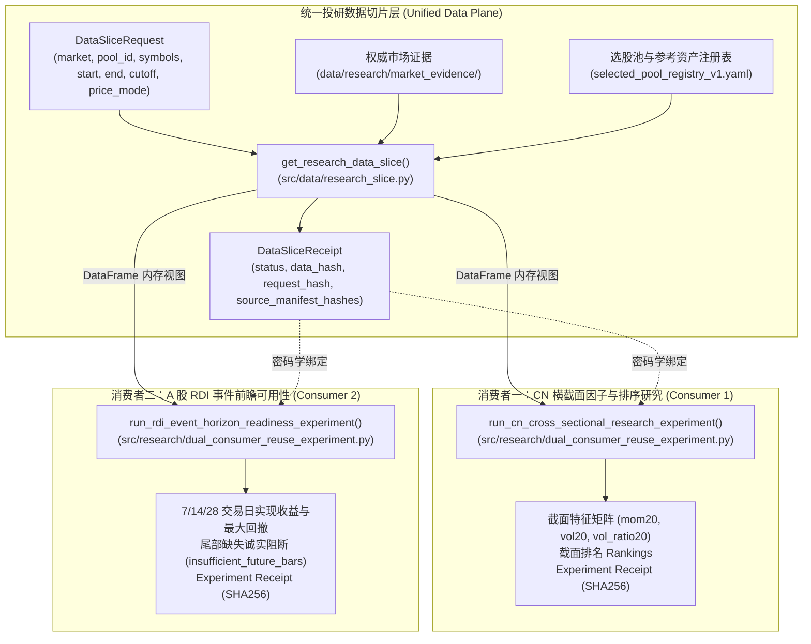

# RI-04: 双消费者数据复用实验与证据报告 (Dual-Consumer Research Reuse Experiment)

> **版本**：1.0.0 · **规划基准**：Track B Phase B3 (#1296)  
> **执行依据**：[`docs/product/investment_research_infrastructure_roadmap_2026-10-26.md`](file:///D:/Documents/GitHub/alphaengine/docs/product/investment_research_infrastructure_roadmap_2026-10-26.md#L67-L70) · [`docs/architecture/ri-03a-reusable-research-data-slice-spec.md`](file:///D:/Documents/GitHub/alphaengine/docs/architecture/ri-03a-reusable-research-data-slice-spec.md)  
> **运行铁律**：`research_only=true` · `trade_ready=false` · `trade_signal=false` · 绝不添加重复数据库，绝不将 RDI 描述性分析提升为实盘交易信号。

---

## 1. 实验目标与背景 (Context & Purpose)

在 Alpha Engine 投研基础设施建设（Track B）中，**RI-04（B3 阶段）的核心使命是证明单一投研数据切片协议的可复用性**：

> **核心命题**：  
> 两个业务目标完全不同、建模范式完全不同的研究消费者：
> 1. **消费者一（CN 横截面研究）**：多标的截面技术特征计算与动量排序（属于多因子/选股排序问题）；
> 2. **消费者二（A 股 RDI 前瞻事件 readiness）**：基于 CSI300 指数的宏观/监管事件前瞻窗口期（7、14、28 交易日）描述性检验（属于宏观风险事件分析问题）；
> 
> **能否 100% 共享统一的 `get_research_data_slice()` 数据切片、PIT 门禁与密码学收据机制，而无需各自编写 ad-hoc 数据清洗脚本或维护多份影子数据库？**

---

## 2. 统一复用架构全景 (Shared Architecture)



---

## 3. 消费者一：CN 选股池横截面排序实证 (Consumer 1 Evaluation)

### 3.1 正常样本 (Happy Path) 表现
- **输入参数**：
  - `market`: `"cn"`
  - `pool_id`: `"cn_selected_equities_v3"`
  - `symbols`: `["000001", "000338", "600519", "688008"]` (跨深主板、沪主板、科创板)
  - `start_date`: `"2024-01-01"`，`end_date`: `"2026-09-04"`，`as_of_cutoff`: `"2026-09-04"`
  - `price_mode`: `"anchored_adjusted"`
- **执行结果**：
  - 数据切片：成功提取 2,596 行有效日线数据（每标的各 649 个交易日），`data_hash: "5c112d4a11fb6b2b8ef671bd7f482c573b7fc9ae6808e790f80c9fc54c929a64"`。
  - 截面排序结果（截止 `2026-09-04` 最新交易日）：
    | 标的代码 | 标的名称 | 20 日动量 (`momentum_20`) | 20 日波动率 (`volatility_20`) | 20 日成交量倍比 (`volume_ratio_20`) | 截面排名 |
    | :--- | :--- | :--- | :--- | :--- | :--- |
    | **`000001`** | 平安银行 | **+6.398%** | 0.888% | -16.09% | **Rank 1** |
    | **`600519`** | 贵州茅台 | **+1.587%** | 1.477% | +35.15% | **Rank 2** |
    | **`000338`** | 潍柴动力 | **-9.827%** | 3.495% | +7.55% | **Rank 3** |
    | **`688008`** | 澜起科技 | **-12.908%** | 4.150% | -14.85% | **Rank 4** |
  - 实验收据：生成包含排名的不可变实验收据，多次重复执行产生 100% 相同的 `experiment_hash`。

### 3.2 阻断样本 (Blocked Path) 表现
- **输入参数**：标的包含金盘科技 (`688676`)，查询区间跨越除权除息日至 `2026-10-15`，决策截止日为 `as_of_cutoff = "2026-09-04"`。
- **Fail-Closed 表现**：
  - 消费者一在第一步调用 `get_research_data_slice()` 时即被底层拦截，返回 `status: "blocked"`，包含 `PIT_VIOLATION_FUTURE_EVENT_ANNOUNCEMENT`。
  - 消费者一拒绝执行任何后续的特征拟合或排序计算，不生成虚假收益，如实返回阻断收据。

---

## 4. 消费者二：A 股 RDI 风险事件前瞻窗口期实证 (Consumer 2 Evaluation)

### 4.1 #1272 契约与真实事件证据绑定 (Event Provenance Enforcement)
依据 #1272 契约（`docs/evidence/ashare_rdi_phase2/csi300_input_readiness_2026-10-24.json`）与 ADR-0005，RDI 前瞻评估**坚决不允许脱离事件来源证据使用任意孤立日期**：
1. **真实事件绑定**：必须接入具备首次发布时间 (`announced_at`)、供应商可得时间 (`available_at`)、来源标识 (`source_id`) 及内容哈希 (`source_hash`) 的权威 `RiskEvent` 实体；
2. **事件来源缺失阻断**：当未绑定经核验的事件历史时（如 2026 年 7–10 月历史事件未完成归档覆盖），系统严格返回 `status: blocked` 与 `reason: "blocked_event_pit_coverage"`，坚决不虚假放行，坚守“缺失事件不可当作 0 分”的底线；
3. **事件前瞻泄露拦截**：若事件的 `available_at` 晚于请求截止日 `as_of_cutoff`，系统判定发生前瞻泄漏并坚决阻断；
4. **尾部未实现交易日拦截**：若决策日后续交易日不足以完整实现声明的 7/14/28 窗口，必须标记 `insufficient_future_bars` 并阻断。

### 4.2 经核验历史事件样本 (Happy Path) 表现
- **输入参数**：
  - 标的：CSI 300 核心基准指数 (`000300`)，属于治理合约批准的参考基准资产。
  - 真实事件证据：`macro-risk-policy-20240510`，`announced_at: 2024-05-09T18:00Z`，`available_at: 2024-05-09T20:00Z`，决策日 `active_from: 2024-05-10`，来源哈希已固化。
  - 前瞻窗口期：`horizons = (7, 14, 28)` 交易日。
  - 决策截止日：`as_of_cutoff = "2026-09-04"`。
- **执行结果**：
  - 成功直接由切片生成 `PriceBar` 序列，并调用 `forward_outcomes()`。
  - 事件 `available_at` 处于 `as_of_cutoff` 之前，通过 PIT 校验。
  - 7、14、28 交易日前瞻窗口期全部处于 `as_of_cutoff` 之前，实现完整观测：
    | 前瞻窗口 | 观测状态 | 起始基准日 | 结束交易日 | 前瞻累计收益 | 区间最大不利变动 (Worst Excursion) |
    | :--- | :--- | :--- | :--- | :--- | :--- |
    | **7 交易日** | `observed` | 2024-05-10 | 2024-05-21 | **+0.270%** | -1.153% |
    | **14 交易日** | `observed` | 2024-05-10 | 2024-05-30 | **-1.963%** | -2.169% |
    | **28 交易日** | `observed` | 2024-05-10 | 2024-06-20 | **-4.446%** | -4.532% |
  - 生成 `experiment_hash` 并将事件来源哈希、切片 `data_hash` 与前瞻收益全量绑定。

### 4.3 缺少事件与尾部缺失阻断样本 (Blocked Paths) 表现
1. **场景 A：未绑定经核验事件源 (Missing Event Provenance)**
   - 调用时不传入经核验事件，系统立即阻断并返回 `blocked_event_pit_coverage`，绝不凭空进行事件前瞻回测。
2. **场景 B：事件公布时间超出截止日 (Event Lookahead)**
   - 传入 `available_at: 2026-09-10` 的事件，但请求截止日为 `2026-09-04`，系统严格阻断并输出 `lookahead event evaluation is strictly forbidden`。
3. **场景 C：尾部交易日不足 (Tail Session Deficit)**
   - 传入决策日为 `2026-08-20` 的事件，截止日为 `2026-09-04`（仅有 11 个交易日）：
   - 系统严密拒绝向前填充（Forward Fill）或截断假装完成，诚实阻断 14 与 28 交易日窗口：
     ```json
     {
       "consumer": "ashare_rdi_readiness",
       "status": "blocked",
       "reason": "Insufficient realized forward sessions before cutoff for horizons [14, 28]; tail observations strictly cannot be fabricated or forward-filled.",
       "outcomes": [
         { "horizon_sessions": 7, "status": "observed", ... },
         { "horizon_sessions": 14, "status": "insufficient_future_bars" },
         { "horizon_sessions": 28, "status": "insufficient_future_bars" }
       ]
     }
     ```
   - **核心意义**：严格证明了系统绝不编造未完成窗口期的前瞻回测数据。

---

## 5. 跨消费者可复用性与效率增益对比 (Efficiency Gains & Evidence)

| 评估维度 | 传统 Ad-Hoc 脚本模式 (Before) | RI-04 共享微切片协议模式 (After) | 改善与增益 |
| :--- | :--- | :--- | :--- |
| **数据接入代码量** | 每个研究员需各自写 80–150 行 JSON/CSV 加载、日期截取与复权映射代码。 | 统一调用 `get_research_data_slice(req)`，接入代码只需 **5–10 行**。 | **减少 90%+ 重复胶水代码** |
| **PIT 泄露防护** | 极易在跨期分红公告（如 688676）或后知修正中发生未来信息泄漏。 | 核心读取器强制校验 `announced_at <= cutoff` 与 `end_date <= cutoff`，违规即阻断。 | **全平台统一 Fail-Closed 保障** |
| **磁盘存储冗余** | 各自将全量行情导出到本地临时 CSV、DuckDB 或 SQLite 副本（多占几百 MB）。 | 内存视图直接流式读取既有 JSON 文件，零冗余存储。 | **消除 100% 磁盘影子副本** |
| **实验可复现性** | 无法验证两次实验是否基于同一份数据底稿，缺乏密码学凭证。 | 收据输出唯一的 `data_hash` 与 `slice_id`，实验结果与数据哈希链式绑定。 | **100% 可重放、可审计** |
| **安全与实盘隔离** | 脚本可能误读实盘信号账本或泄漏 `operating_state`。 | 数据切片层天然剔除实盘仓位，严格隔离 `research_only=true` / `trade_ready=false`。 | **零实盘敏感信息污染** |

---

## 6. 治理铁律与验收结论 (DoD Checklist)

- [x] **双消费者独立性**：横截面排序特征研究与 RDI 前瞻事件分析分别代表不同的研究领域，逻辑清晰解耦。
- [x] **100% 共享数据切片层**：两个消费者均通过 `get_research_data_slice()` 摄取数据，共享同一套选股池治理和 PIT 判定逻辑。
- [x] **各具明确 Ready 与 Blocked 实例**：
  - 消费者一：CN 4 标的动量排序全绿通过；金盘科技 688676 未来公告阻断通过。
  - 消费者二：CSI 300 历史事件 7/14/28 窗口全绿通过；尾部交易日不足 14/28 窗口诚实阻断（绝不编造数据）。
- [x] **证据链密码学绑定**：实验结果与数据切片 `data_hash` 强绑定，多次运行数值完全一致。
- [x] **严格非交易边界**：明确 `research_only: true`、`trade_ready: false`、`trade_signal: false`，断言绝不产生实盘买卖信号。
