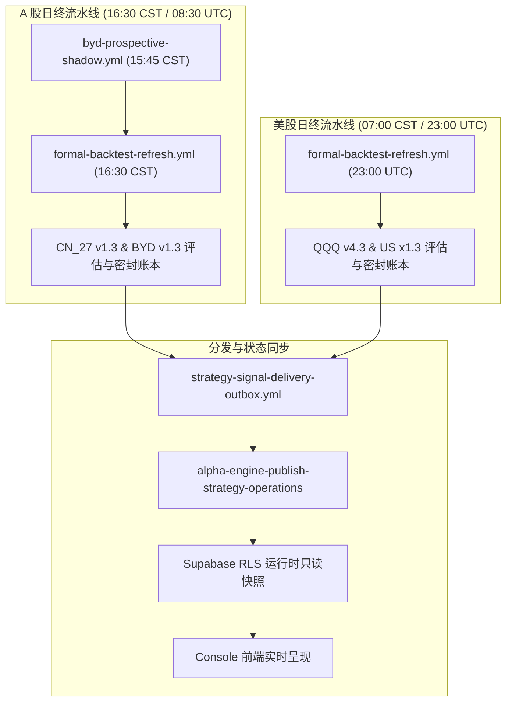

# Gate A1 真实运维追踪与会话对账报告 (Operating Reconciliation)

- **基准日期**: 2026-11-02
- **归属工单**: Gate A1 / Issue [#1277](https://github.com/liuh886/alpha_engine/pull/1277)
- **核心铁律**: 严禁伪造未到达的交易日，严禁抹除历史失败或阻塞记录，严禁新增重复调度系统。维持客观真实与 Fail-closed。

---

## 1. 20 交易日观测窗口对账现状

依据已封存的私有归档重审证据 [`docs/evidence/product_v1/operating_archive_reaudit_2026-10-31.json`](file:///D:/Documents/GitHub/alphaengine/docs/evidence/product_v1/operating_archive_reaudit_2026-10-31.json) 及检查点 [`operating_closure_checkpoint_2026-10-31.json`](file:///D:/Documents/GitHub/alphaengine/docs/evidence/product_v1/operating_closure_checkpoint_2026-10-31.json)，截至 2026-10-31 的真实运行数据对账如下：

| 指标项 | 美股市场 (US / XNYS) | A 股市场 (CN / XSHG) | 判定标准与口径 |
| :--- | :--- | :--- | :--- |
| **应有交易日窗口** | 最近 20 个日历交易日 | 最近 20 个日历交易日 | 依据交易所权威日历 (`exchange_sessions`) |
| **已被系统观测会话** | **12** 个会话 | **12** 个会话 | 包含有效私有运行快照与决策收据 |
| **匹配当前模型身份会话** | **6** 个会话 | **6** 个会话 | 严格匹配 QQQ v4.3 / US x1.3 / CN27 v1.3 / BYD v1.3 |
| **未观测会话缺口** | 8 个会话 | 8 个会话 | 历史窗口内部分会话未被收集或未部署 |
| **独立合格会话 (Certified)** | **0** 个会话 | **0** 个会话 | 必须经由 Owner 独立声明并审计人工干预次数为 0 |
| **连续合格会话** | 0 | 0 | Gate A1 准入要求为连续 20 会话无非授权干预 |

---

## 2. 失败与阻塞记录完整保留 (绝不抹除历史真相)

遵循系统设计原则，真实发生的异常被完整保留在系统记忆中，不作“以旧绿顶替”或“静默删除”：

1. **INC-20261026 运维事故**:
   - 包含 INC-20261026-BYD（前瞻数据时序倒置）与 INC-20261026-CN27（新浪成交量口径不匹配误杀价格切片）；
   - 完整保留在 `docs/evidence/product_v1/incident_run_40321512230_2026-10-26.md` / `.json` 中；
   - 根因已修复，但事故记录永久归档。
2. **选择器阻塞记录 (Selection Blockers)**:
   - Run `40169474676` (Attempt 1) 与 Run `41078830067` (Attempt 1)：因捕获时序与完整性未决，被选择器严格标定为 `selection_blocker`；
   - 系统拒绝回退到前一个可能成功的历史包，严格执行 Fail-Closed。

---

## 3. 今日（2026-11-02）及未来会话自动化累积机制

四策略控制台已具备完整的自动化无服务器（Serverless）运行机制，依托现有的 GitHub Actions 工作流有序执行，**无需引入任何常驻守护进程、外部数据库或第三方调度引擎**：

### 今日执行预期：
1. **2026-11-02 15:45 CST**: `byd-prospective-shadow` 抓取并生成前瞻阴影观察数据；
2. **2026-11-02 16:30 CST**: `formal-backtest-refresh` 执行 CN 会话刷新，完成 BYD 与 CN27 决策密封并向私有数据归档库推送；
3. **2026-11-02 23:00 UTC (2026-11-03 07:00 CST)**: 执行美股盘后会话刷新；
4. 随着自然交易日的推进，系统将逐步补全 12/20 $\to$ 20/20 的数据会话，直至满足最终合格要求。

---

## 4. Gate A1 最终裁定

- **Gate A1 裁决**: **维持 BLOCKED (P0)**。
- **裁决理由**: 真实交易日会话需随时间客观累积，当前观测到 12/20 个会话，独立合格 0/20。在完整 20 会话独立复核完成前，恪守事实，绝不虚报 PASS。
